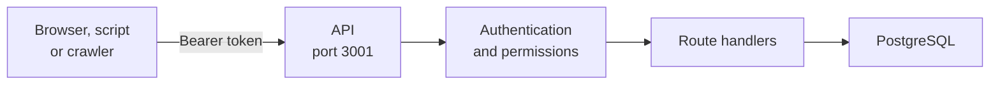

# API Reference Overview

Identity Atlas serves one HTTP API. The web UI, the crawlers, the Excel export and your own integrations all use it. This page covers what every caller needs: where the API lives, how to authenticate, what errors look like, and which limits apply. The pages listed under [Endpoint groups](#endpoint-groups) describe individual endpoints.

Operator settings (the environment variables of the containers) are on the [Configuration](../reference/config.md) page.

## Base URL

Every path in this reference starts with `/api`. Resolve it against the address your deployment is reached at:

| Deployment | Base URL |
|---|---|
| Docker on the same machine | `http://localhost:3001/api` |
| Behind a reverse proxy, a tunnel or Azure | The public URL plus `/api`, for example `https://atlas.example.com/api` |
| Crawlers inside the worker container | `http://web:3001/api` |



## The OpenAPI document

The API serves an OpenAPI 3 document and a Swagger UI for part of its surface. Neither needs a token.

| Path | What you get |
|---|---|
| `/api/docs` | Swagger UI |
| `/api/openapi.json` | The same specification as JSON |

The specification covers the ingest endpoints, crawler management, effective access, attribute labels, reports, saved report views, custom reports, contexts and the context assistant. It does not cover the rest of the read API (the matrix, entity detail, governance, risk scores); the pages below describe those.

## Authentication

Sign-in is a deployment setting. A Docker deployment starts with authentication **off**: every endpoint answers without a token. An Azure deployment starts with it **on**. [Authentication & SSO](../admin/authentication.md) explains how to turn it on.

With authentication on, send a bearer token on every request:

```http
Authorization: Bearer <token>
```

Three kinds of token exist:

| Token | Looks like | Accepted on |
|---|---|---|
| Entra ID access token | A JWT whose audience is `api://<client id>` | Every endpoint the caller's role allows. An ID token is refused. |
| Read API key | Starts with `fgr_` | `GET` requests outside `/api/admin/`. Made for Excel and BI tools; see [Excel Export (Power Query)](../admin/excel-powerquery-export.md). |
| Crawler API key | Starts with `fgc_` | `/api/ingest/*` and `/api/crawlers/*` only. These endpoints require the key even when authentication is off. See the [Ingest API](../architecture/ingest-api.md). |

A signed-in user gets the permissions of their role. A user without a role is refused with `403` on everything except `/api/auth-me`, unless [context-owner access](../architecture/context-owner-access.md) lets them in. [Permissions & Roles](../reference/permissions.md) lists the permission each group of endpoints requires.

### Endpoints that never need a token

| Endpoint | Returns |
|---|---|
| `GET /api/health` | `{ "status": "ok", "schemaReady": true }`. Always `200` once the port is open; `schemaReady` is `false` while database migrations still run. |
| `GET /api/version` | The running version, and whether the compose file is out of date. |
| `GET /api/features` | Which optional features are switched on. |
| `GET /api/auth-config` | `{ enabled, configured, tenantId, clientId, platform }`: what the UI needs to start sign-in. |
| `GET /api/docs`, `GET /api/openapi.json` | The OpenAPI document (see above). |

## Errors

An error response is a JSON object with an `error` field that holds a readable message:

```json
{ "error": "Invalid entity ID format" }
```

Some errors add fields next to `error`. A permission refusal lists what was needed and what the caller has:

```json
{
  "error": "Insufficient permissions",
  "required": ["data.write.risk"],
  "have": ["data.read"]
}
```

A signed-in user without any role gets `"code": "NO_ROLE"` next to the message.

Exceptions to this shape:

- The LLM settings endpoints `POST /api/admin/llm/test` and `POST /api/admin/llm/models` answer `{ "ok": false, "error": "..." }`.
- The MCP endpoint answers JSON-RPC error objects. See [MCP Server](../reference/mcp-server.md).
- A request that is rejected before it reaches a handler (malformed JSON, or a JSON body over the size limit) has no JSON `error` body. Rely on the status code.
- A few action endpoints confirm success with `{ "message": "..." }`, for example cancelling a crawler job. That field is not used for errors.

| Status | Meaning |
|---|---|
| `400` | Invalid parameter or body |
| `401` | Missing, invalid or expired token |
| `403` | Valid token, but the caller lacks the permission, or a read API key was used for something other than a permitted `GET` |
| `404` | Not found. Also the answer of every endpoint of an optional feature that is switched off. |
| `409` | Conflicts with the current state, for example starting a risk scoring run while one is in progress |
| `413` | Body or upload too large |
| `421` | Authentication is off and the request's `Host` name is not an allowed host. See `ALLOWED_HOSTS` under [Security and reverse proxy](../reference/config.md#security-and-reverse-proxy). |
| `429` | Rate limit exceeded |
| `500` | Internal error. The message never contains SQL or schema details. |
| `503` | The database schema is still migrating after a start or an upgrade. The response carries `Retry-After: 30`. |
| `507` | An upload would leave too little free disk space |

## Limits

### Rate limits

Every limit counts per minute. Authenticated limits count per caller (user, read API key or crawler); unauthenticated ones count per client address.

| Applies to | Limit per minute |
|---|---|
| Any authenticated `/api` request | 6,000 per caller |
| Requests that fail before authentication | 6,000 per client address (successful requests do not count) |
| `/api/health`, `/api/version`, `/api/features`, `/api/auth-config` | 600 per client address |
| LLM generation for risk profiles and classifiers | 10 per caller |
| Changing the role-to-permission mapping | 10 per caller |
| Cleaning the database and pruning history | 5 per caller |
| A crawler API key | The limit set on that crawler; 100 when none is set. The built-in worker gets at least 2,000. |
| Failed crawler API key attempts | 10 per client and key prefix, 100 per client |

### Request size

| Applies to | Limit |
|---|---|
| JSON bodies, unless listed below | 100 KB |
| `/api/ingest/*` | 50 MB per request |
| `/api/admin/import` | 2 MB |
| Crawler file uploads | 8 GiB per file by default (`UPLOAD_MAX_FILE_BYTES`). An upload is also refused when it would leave less than 1 GiB free on the volume (`UPLOAD_MIN_FREE_BYTES`). |
| Context file uploads | 200 MB per file |
| Interview transcript uploads | 25 MB per file |

## Lists and pagination

There is no single list format. Check the page of the endpoint you call. What you will meet:

- **Paged lists** take `limit` and `offset` and return `{ "data": [...], "total": 1042 }`. Each endpoint has its own default and maximum `limit`. The bulk lists that the Excel export reads (`/api/assignments` and its siblings) return `total` on the first page only; on later pages it is `null`.
- **Plain arrays.** Several endpoints return the rows directly, without an envelope and without paging. Version history (`GET /api/user/:id/history`) is one.
- **Named objects.** Detail endpoints return an object with their own field names.

## Endpoint groups

| Group | Paths | Reference |
|---|---|---|
| Matrix and permissions | `/api/permissions`, `/api/access-package-groups`, `/api/matrix/columns`, `/api/sync-log` | [Matrix & Permissions](matrix.md) |
| Effective access | `/api/resource/:id/effective-access`, `/api/effective-access/resolve` | [Matrix & Permissions](matrix.md#effective-access) |
| Accounts | `/api/users`, `/api/user/:id` | [Entity Detail](entities.md#users) |
| Resources | `/api/resources`, `/api/resources/:id` | [Entity Detail](entities.md#resources) |
| Business role detail | `/api/access-package/:id` | [Entity Detail](entities.md#business-role-detail) |
| Systems and contexts | `/api/systems`, `/api/contexts/tree` | [Entity Detail](entities.md#systems-contexts) |
| Identities | `/api/identities` | [Entity Detail](entities.md#identities) |
| Account linking | `/api/account-linking` | [Entity Detail](entities.md#account-linking) |
| User preferences | `/api/preferences` | [Entity Detail](entities.md#user-preferences) |
| Performance metrics | `/api/perf` | [Entity Detail](entities.md#operations) |
| Business roles and review compliance | `/api/access-packages`, `/api/governance` | [Governance & Business Roles](governance.md) |
| Categories and tags | `/api/categories`, `/api/tags` | [Governance & Business Roles](governance.md#category-management) |
| Risk scores and scoring runs | `/api/risk-scores`, `/api/risk-scoring/runs` | [Risk Scores](risk-scores.md) |
| Org chart | `/api/org-chart` | [Risk Scores](risk-scores.md#org-chart) |
| Ingest and crawler keys | `/api/ingest`, `/api/crawlers` | [Ingest API](../architecture/ingest-api.md) |

### Areas without a reference page

These areas have no page in this reference yet.

Described in the OpenAPI document at `/api/docs`:

- Reports (`/api/reports`) and saved report views (`/api/report-views`)
- Custom reports (`/api/nl-reports`)
- Context assistant (`/api/context-assistant`)
- Contexts beyond the tree (`/api/contexts`, `/api/context-trees`)
- Crawler management (`/api/admin/crawlers`)

Not described anywhere yet; the route files under `app/api/src/routes/` are the source:

- Context plugins (`/api/context-plugins`)
- Risk profiles and classifiers (`/api/risk-profiles`, `/api/risk-classifiers`)
- Matrix data, saved filters and matrix shares (`/api/matrix/data`, `/api/matrix/saved-filters`, `/api/matrix/shares`)
- Lookups (`/api/lookups`)
- Recent changes, timelines and snapshots (for example `/api/user/:id/recent-changes`)
- Administration under `/api/admin/`: dashboard statistics, feature switches, LLM settings, roles, read API keys, history retention, updates and crawler jobs
- Bulk lists for the Excel export (`/api/assignments`, `/api/identity-members`, `/api/resource-relationships`)
