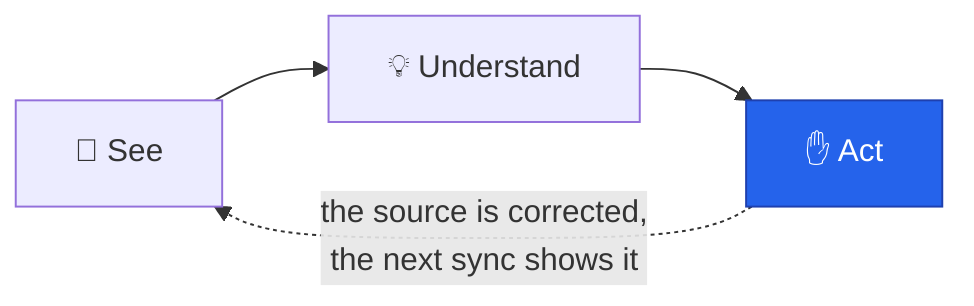
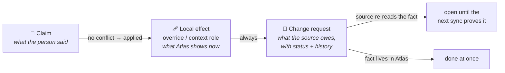
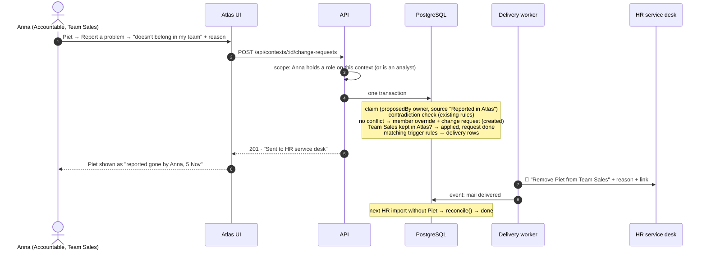
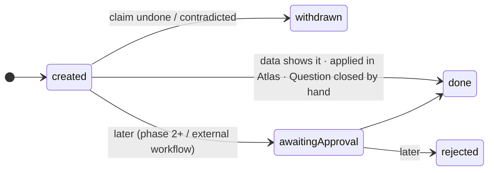
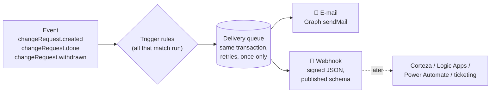
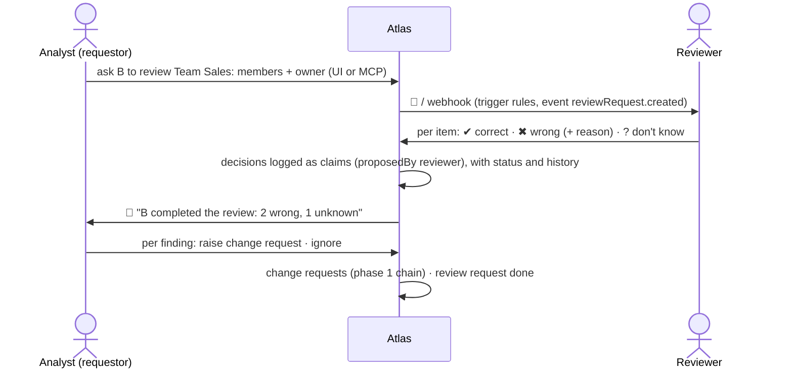

# Acting on what you see: change requests, then review requests

**Status:** design proposal, revision 3 (2026-11-05; checked against `main` 2026-11-16). Nothing built.
Revision 1 proposed a broad framework (actions, campaigns, Corteza). The team discussion narrowed
it: first **change requests** alone, then **review requests**, and only then an external workflow
engine. This revision describes those two phases and sizes phase 1.

**Built on the line-manager POC stack**, now on `main` (#1369 → #1490, behind the feature flag
`orgKnowledge`, off by default; `GET /api/change-requests` answers only with it on): [Change requests](change-requests.md) (migration 103),
[Context interviews](context-interviews.md) (claims, contradictions, member overrides),
[Context-owner access](context-owner-access.md) (relative permissions). Related: the MCP server
(#1508), the [Ownership survey](ownership-survey.md) spec (superseded by phase 2 here).

---

## 1. The gap

People can **see** what they are accountable for and **understand** it (reports, matrix, MCP).
The last step is letting them **act**:

> *"This person doesn't belong in my team."*
> *"This entitlement should not be on my application."*
> *"I want to set a new owner, or a delegate."*

## 2. Decisions

| # | Decision |
|---|---|
| D1 | **Atlas does not write to external source systems.** It records the correction, can notify or call out, and follows whether the source changed. A sent mail or a workflow saying "applied" proves nothing. |
| D2 | **A change request is done when the source data says so.** For a fact that lives only in Atlas and is not in conflict (a Responsible, a hand-kept context), the change is applied directly and the request is done at once. |
| D3 | **Raising a request changes what Atlas shows, the way a confirmed claim does today**: the member is flagged *reported gone*, the new owner is set — as a visible layer on top of the source, never a change to the source's rows. |
| D4 | **Phase 1 is change requests only.** No campaigns, no review requests, no Corteza. |
| D5 | **Triggers are simple and configurable in Atlas**: e-mail, and a webhook with a published JSON schema. The webhook is the hook for Corteza or any other system later. |
| D6 | **Status and history from day one**, with two statuses now (`created`, `done`) and room for more later (`awaitingApproval`, …). |
| D7 | **Phase 1 scope: context-related requests** — a member who doesn't belong, an entitlement that shouldn't be there, a new owner or delegate. |
| D8 | **Mail through Microsoft Graph `sendMail`.** No SMTP. Other transports can be added behind the same interface later. |
| D9 | **Build on the POC stack**, reusing its claims, overrides, change requests and history. |
| D10 | **Phase 2 is review requests**: one person asks another to review attributes or relationships; the decisions are logged; the requestor is told and chooses what to do next (raise change requests, ignore). Automating that hand-over comes later. |
| D11 | **Human input is always recorded; conflicting human statements go through the existing contradiction detection**, and an analyst resolves them before anything is applied or raised. An authorised owner's statement beats the source value — a difference with the source is the reason for the request, not a conflict. |

## 3. Three things, kept apart

All three exist on the POC stack today; phase 1 adds the **entry point** (a report by an owner or
analyst), the **triggers**, and **status + history** on the request.

---

## 4. Phase 1: change requests

### 4.1 What a user can report

| The user says | On | Claim | Local effect | Request kind |
|---|---|---|---|---|
| *"This person doesn't belong in my team"* | an org unit's member | membership: left | member override (exists: `ContextMemberOverrides`) | `RelationshipRemove` |
| *"This entitlement should not be on my application"* | a resource context's member | membership: left, subject = resource (new: `ContextClaims.subjectKind` allows only `Context` / `Person` today) | member override, memberId = the resource | `RelationshipRemove` |
| *"X is the owner, not me"* / *"I want X as owner"* | the context's Accountable | role: owner = X | `ContextRoles` Accountable → X (exists: the `decideClaim` role path, with `sourceClaimId`) | `AttributeUpdate` (owner) |
| *"Add Y as a delegate"* | the context's Responsibles | role: dayToDay = Y | `ContextRoles` Responsible + Y | `RelationshipAdd` |
| *"Something is off here"* | any of the above | — | none | `Question` (new kind, routes to a person) |

Not in phase 1: *"this person is missing"* (no add-override exists), remarks about an assignment
outside a context ("Piet should not have this role"), role composition. These are phase 2+
subjects on the same table.

### 4.2 What happens when someone reports

If the claim **conflicts** with another human statement (an interview says Piet is current), the
chain stops after step 4: the claim is stored, the contradiction shows on the context page, and an
analyst decides it — as today. No override, no request, no mail. The reporter is told *"Someone
said otherwise; an analyst will look at it."*

### 4.3 When is it done?

| Fact | Request | Done when |
|---|---|---|
| Re-read from a source (synced members, synced owner, re-imported upload) | `created` | the next sync / import shows the change. `reconcile()` exists but closes only `RelationshipRemove` (the member is no longer listed); closing an owner change by data is new (see 4.8, *Checked*) |
| Lives in Atlas (hand-kept context, Responsibles, an analyst-set owner) | `created` → `done` in the same transaction | immediately; the applied effect is the change |
| `Question` | `created` | a person marks it done (the only manual close) |
| Any | `withdrawn` | the claim is undone, or a later confirmed claim says the opposite (exists) |

Today's rule "no request for a hand-kept context, nor for a rule-generated one" (`contexts/changeRequests.js`) changes for hand-kept contexts: **every report raises a request**, so
*My requests* is complete and the triggers fire uniformly; the Atlas-owned ones are just done at
once. A rule-generated context still has no source this slice can name (the rule's input); see O6.

### 4.4 Status and history

- `requestStatus`'s CHECK changes to `created`, `done`, `withdrawn` now (`open`/`resolved`
  renamed), and the later values added when they are used. The `ck_ChangeRequests_closed`
  constraint and the open-only unique index `uq_ChangeRequests_open` name `'open'` and move with
  the rename.
- **History**: every column change is already in `_history` (trigger from migration 103). Phase 1
  adds `ChangeRequestEvents` for the things that are not a column change: *mail delivered to …*,
  *webhook accepted by …*, *delivery failed (3 attempts)*, *closed by Anna: "spoke to HR"*, and later
  *approved by …*. The request's detail shows both as one timeline.

### 4.5 Triggers

An **action** is one delivery for one event. No steps, no waiting, no branching — that is the line
that keeps it from becoming a workflow engine.

| | |
|---|---|
| **Rule** | *when* event + filters (target system, request kind, context template) → *then* action + config. Configured in **Admin → Triggers** |
| **E-mail** | Graph `sendMail` from a configured mailbox (`Mail.Send` application permission, restricted to that mailbox with an application access policy). Recipients: the target system's **correction contact** (new field on `Systems`), a fixed address, the context's Accountable, the reporter. One template with summary, reason, reporter, link |
| **Webhook** | `POST` with an HMAC signature header. Body = the change request as the API returns it, wrapped in `{ type, id, time, data }`. The schema is part of OpenAPI and served at `GET /api/change-requests/schema`, so a receiver can bind to it |
| **Delivery** | queue row written in the reporter's transaction; a worker (the API's existing scheduler loop) delivers with back-off and an idempotency key; outcome → `ChangeRequestEvents` |
| **Plug-in shape** | a static registry like `contexts/plugins/registry.js`: `name`, `configSchema` (drives the admin form), `deliver(event, config)`. Secrets via `secrets/` |

### 4.6 Where it shows

- **Context page, People overview / members list**: *Report a problem* on a row (also on the owner's
  read-only page). Dialog: what's wrong (radio), reason, and *"This goes to: HR service desk"*
  before sending. Afterwards the row is flagged the way an override is today: *reported gone by
  Anna, 5 Nov*.
- **Context page, roles block**: *Set owner* / *Add delegate* for the Accountable.
- **Change requests panel** (exists): gains reason, reporter, status, and a detail with the
  timeline. A **My requests** list for the reporter.
- **Admin → Triggers**: rules list, form from each action's `configSchema`, test-send.

### 4.7 API

| Route | Who |
|---|---|
| `POST /api/contexts/:id/change-requests` `{ kind, memberId \| principalId \| identityId, reason }` | analysts; context owners for their own contexts (new owner-mode write entry) |
| `GET /api/change-requests` (exists; filters + `raisedBy=me`) · `GET /api/change-requests/:id` (with events) | same scope as today |
| `POST /api/change-requests/:id/close` `{ comment }` | `Question` only; analysts and the reporter |
| `GET /api/change-requests/schema` | public to signed-in users |
| `GET/PUT /api/admin/trigger-rules` · `POST /api/admin/trigger-rules/:id/test` | `admin.*` |

### 4.8 Existing building blocks, and additions

| Reused as is | Where |
|---|---|
| Claims with status, decider, quote | migration 099, `contexts/interviews/claims.js`, `decide.js` |
| Hand-made claim pattern (source row per unit, confirmed by its maker) | `contexts/orgKnowledge/manual.js` |
| Contradiction rules incl. *claims disagree* | `contexts/interviews/contradictions.js` |
| Member override, undo, "former" display with *Undo decision* | migration 101, `interviews/memberOverrides.js`, `components/contexts/people/` (People section, `PersonClaims.jsx`) |
| Context role set from a claim, with `sourceClaimId` | `decide.js` role path, migrations 095/099 |
| Change request raise / withdraw / reconcile-by-data, panel | migration 103, `contexts/changeRequests.js`, `ChangeRequestsPanel.jsx` |
| History trigger | `fg_record_history` |
| Owner scope + allow-list (reads only today; the one POST is the team-matrix read) | `middleware/contextOwnerMode.js`, `auth/contextOwnerScope.js` |
| Secrets store | `secrets/` |

| Addition | Size |
|---|---|
| `ContextClaims.proposedBy` CHECK + `owner` (today `model` / `analyst`); `subjectKind` + `Resource`; a "Reported in Atlas" source row (a `ContextInterviews` row, since `interviewId` is required) per reporter per context — the *Analyst notes* pattern | S |
| `ChangeRequests`: `reason`, `raisedVia`, `changeKind` + `Question`, statuses renamed + extended; `ChangeRequestEvents`; "every report raises a request, Atlas-owned ones done at once" | S |
| `reconcile()` for an owner `AttributeUpdate`: done when the source's owner (`Contexts.ownerUserId` resolved, or a crawler-stated Accountable) is the expected one | S |
| Member override for a **resource** member (`memberId` already untyped; `memberFacts.js` is person-oriented — check) | S |
| `Systems.correctionContact` (or in `extendedAttributes`) + admin field | S |
| Owner-mode write entry for the POST, scoped to the owner's contexts | S |
| `TriggerRules`, `DeliveryQueue`; registry; worker with retries; admin CRUD | M |
| Graph `sendMail` transport + mailbox config + app permission docs | M |
| Webhook action + signature + published schema | S |
| UI: report dialog, flags on rows, panel detail + My requests, Admin → Triggers | M |
| Docs (`change-requests.md`, new `triggers.md`, Graph permission how-to), OpenAPI, changelog | S |

**Checked (2026-11-16):** a source sync never overwrites an analyst-set Accountable. The ingest
(`ingest/contextOwners.js`, migrations 097 and 105) is no longer insert-only: it adds, replaces
or removes the Accountable it wrote itself (`addedBy 'sourceOwner'`), and leaves every other one
alone; the Accountable is unique per context. So an owner change set from a report (`addedBy
'analyst'`) holds until someone changes it again; it needs no override layer. The change request
for a synced owner stays `created` until the source shows the new owner — and because the sync
then cannot write that owner into `ContextRoles` (the analyst row holds the slot), the check must
read the source's owner value, not the role row.

### 4.9 Build order (one PR each, from `main`)

1. **Report → claim → effect → request** (API + DB + the report dialog + row flags). Useful alone:
   requests show in the panel, closed by data.
2. **Status, events, My requests, close for Questions.**
3. **Triggers: queue + worker + webhook + Admin → Triggers.** Webhook first: no external
   dependency, and it proves the queue.
4. **E-mail via Graph** (transport, mailbox setup, docs) + correction contact on systems.

Rough feel: 1 and 2 a few days each; 3 and 4 about a week each. No new infrastructure.

### 4.10 Tests that matter

- Owner of **another** context → 403; owner of a **parent** → allowed only under the existing
  sub-unit rule.
- Conflicting interview claim → claim stored, **no** override, **no** request, **no** delivery row,
  contradiction visible.
- Hand-kept context → override + request already `done`; `created` rule did fire, `done` rule did
  fire.
- Two rules match → two deliveries; worker restart mid-delivery → each sent **once**.
- Delivery failure → retries, `failed` event; request stays `created`, never `done`.
- Mail delivered → still `created`; next import without Piet → `done`.
- Undo the claim → override gone, request `withdrawn`, `withdrawn` rule fires.

---

## 5. Phase 2: review requests (MVP)

- **Object:** `ReviewRequests` — requestor, reviewer, context, what to review (members, roles,
  attributes, relationships — a list of items), status (`created`, `inProgress`, `completed`,
  `cancelled`, `expired`), `dueAt`, `createdVia` (ui / mcp / api). Items carry the reviewer's
  decision, reason and time. History via `_history` + the same events table.
- **Answers are claims** (`proposedBy reviewer`), so contradictions with interviews or other
  reviewers show in the existing place.
- **The requestor decides what to do next** per finding: raise a change request (phase 1 chain),
  or ignore. Automating that step ("apply all") comes after the MVP.
- **Notifications** reuse phase 1 triggers: events `reviewRequest.created` / `.completed`; the
  template is configurable per rule.
- **Easy to ask:** one button on the context page (*Ask for a review*: pick reviewer, tick what,
  due date), and an MCP tool `request_review` on the same route, so an assistant can set it up from
  a conversation. Everything is stored in Atlas, never only in the chat.
- Not in the MVP: multi-reviewer sequences, campaigns, approval of the answers. A later orchestrator
  (Corteza via the webhook, a script, an AI) can chain review requests; Atlas never sequences them.

## 6. Later

- **External workflow (Corteza or other):** binds to the webhook, creates review requests and
  closes change requests through the API. Verify footprint, auth both ways, and durability over
  long waits before choosing Corteza; the webhook + API don't change either way.
- **More subjects:** assignments outside a context, role composition, "person missing".
- **MCP write tools:** `propose_change`, `request_review` — same routes, same scope, confirmation
  shown to the user first.

## 7. Open choices

| # | Question | Phase 1 default |
|---|---|---|
| O1 | Ordinary employees reporting about their own access | not in phase 1: owners in scope + analysts |
| O2 | Five people report the same thing: one request or five? | one open request per fact (the existing unique index); later reports attach as supporting claims |
| O3 | How long may a request stay `created` before someone is reminded? | no reminder in phase 1; a `created` rule with a delay is the natural later form |
| O4 | Delivery worker: in the API's scheduler loop, or the PowerShell worker? | API scheduler (it already ticks every minute, and the code is JS) |
| O5 | Owner changing a context kept in Atlas: applied directly (as decided) — should the previous owner be notified? | a trigger rule on `done` with recipient "previous Accountable" covers it |
| O6 | A report on a rule-generated context: where does it go? | the request is raised without a target system and reaches people only through a trigger rule (no close-by-data); naming the rule's input as target comes later |
