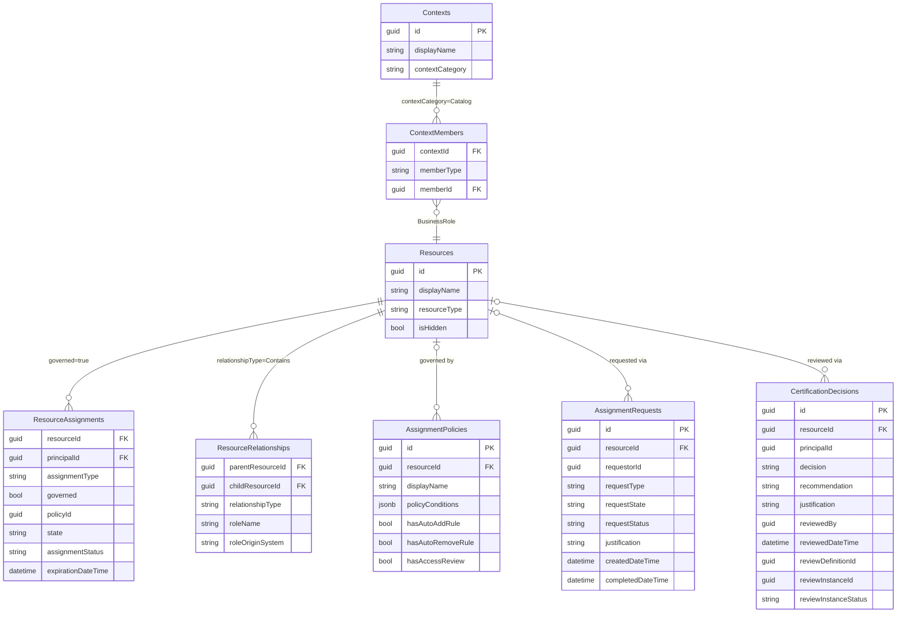
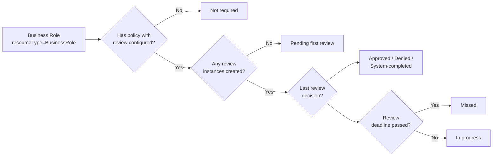

# Governance Model

!!! info "Before this page"
    Assumes you have read **[Data Model](./data-model.md)**.
    Brand new? Start at [The words you need first](../start/glossary.md).

Identity Atlas supports business roles, certification reviews, and access policies from any IGA platform — not just Entra ID. The governance model is unified with the resource model: business roles **are** Resources, their assignments **are** ResourceAssignments, and their resource grants **are** ResourceRelationships. Only governance-specific metadata (policies, requests, certification decisions) lives in dedicated tables.

---

## Overview

In v3.1, the governance model was merged into the universal resource model. The practical effect is that business roles from any IGA platform participate in the same views, risk scores, and queries as Entra ID groups and directory roles — without a separate schema.

The unification uses discriminator columns:

- `Resources.resourceType = 'BusinessRole'` — identifies business roles among all resources
- `ResourceAssignments.governed = true` — flags governed assignments among all assignments (the `assignmentType` stays one of the three universal values `Direct` / `Indirect` / `Eligible`)
- `ResourceRelationships.relationshipType = 'Contains'` — identifies resource grants among all relationships

The three governance-specific tables (`AssignmentPolicies`, `AssignmentRequests`, `CertificationDecisions`) contain only data that has no place in the shared model.

A **catalog** — the container a governance source groups its business roles in — is a synced context of the `Catalog` template (`contextCategory = 'Catalog'`), not a table of its own. Its members are the business roles it holds, the source's catalog properties sit in its `extendedAttributes`, and the people who answer for it are its Accountable and Responsible. The UI calls them **role portfolios**: they have their own **Role portfolios** tab on the Contexts page, and someone who is Accountable or Responsible for one finds it on the same sub-tab of their owner page (see [Context-owner access](../architecture/context-owner-access.md)). Until migration 117 they lived in a `GovernanceCatalogs` table with a `Resources.catalogId` pointer; that table is gone and the next crawl writes the catalogs again as contexts.

!!! info "Breaking change from v3.0"
    In v3.0, governance used seven separate tables: GovernanceCatalogs, BusinessRoles, BusinessRoleResources, BusinessRoleAssignments, BusinessRolePolicies, BusinessRoleRequests, and CertificationDecisions. In v3.1, three of those were absorbed into the shared resource model. Existing v3.0 deployments must re-sync to populate the unified tables.

---

## Governance Entity Diagram

<!-- ontology: validated -->


---

## IGA Platform Mapping

The same governance tables absorb data from any IGA platform. The source platform determines the sync method; the model is always the same.

| Concept | Entra ID | Omada | SailPoint | Table |
|---|---|---|---|---|
| Catalog / Container | Catalog | — | Source | `Contexts` (`contextCategory = 'Catalog'`), members in `ContextMembers` |
| Business Role | Access Package | Business Role | Access Profile | `Resources` (`resourceType = 'BusinessRole'`) |
| Resource Grant | Resource Role Scope | Role Entitlement | Entitlement | `ResourceRelationships` (`relationshipType = 'Contains'`) |
| Assignment | AP Assignment | Role Assignment | Access Request Result | `ResourceAssignments` (`governed = true`) |
| Policy | Assignment Policy | Assignment Policy | Access Request Config | `AssignmentPolicies` |
| Request | AP Assignment Request | — | Access Request | `AssignmentRequests` |
| Certification | Access Review Decision | CRA | Certification | `CertificationDecisions` |

---

## Governance-Specific Columns

The unified model extends the three shared tables with extra columns that carry governance semantics. These columns are `NULL` for non-governance rows, so they do not break existing queries.

These columns are created by the PostgreSQL migrations (`001_core_schema.sql`, `047_governed_assignment_flag.sql`).

### Resources (business roles)

| Column | Type | Purpose |
|---|---|---|
| `isHidden` | BOOLEAN | Hides the business role from self-service request portals |

### ResourceAssignments (governed assignments)

| Column | Type | Purpose |
|---|---|---|
| `governed` | BOOLEAN | `true` marks the assignment as governed (channelled through an IGA business role / access package). Defaults to `false`. This flag — not a dedicated `assignmentType` — is what distinguishes governed access from direct access |
| `policyId` | UUID | The `AssignmentPolicies` row that granted this assignment |
| `state` | TEXT | Lifecycle state: `Delivered`, `Expired`, `PendingApproval`, etc. |
| `assignmentStatus` | TEXT | Finer-grained status from the source IGA platform |
| `expirationDateTime` | TIMESTAMPTZ | When the assignment expires (NULL = no expiry) |

### ResourceRelationships (business role resource grants)

| Column | Type | Purpose |
|---|---|---|
| `roleName` | TEXT | The role within the target resource: `Member` or `Owner` |
| `roleOriginSystem` | TEXT | Which system defined this role (e.g. `EntraID`, `Omada`) |

---

## IST vs SOLL Analysis

Identity Atlas uses IST/SOLL terminology to express the gap between actual access and governed access.

**SOLL (should-be state)**
Access granted through a business role. Rows in `ResourceAssignments` where `governed = true`. This is access that was formally requested, approved, and periodically reviewed.

**IST (as-is state)**
Direct access assignments outside governance. Rows in `ResourceAssignments` where `governed = false` (typically `assignmentType = 'Direct'`). This is access that exists but was not channeled through the IGA process.

**The gap**
Users who have direct membership to a group that is also granted by a business role. They have the access, but not through the approved channel. This is the primary finding that role mining and certification campaigns aim to remediate.

The following SQL views expose the IST/SOLL picture:

```sql
-- All access assignments outside business role governance
SELECT * FROM vw_UnmanagedPermissions;

-- A principal's full access picture: every assignment and how it was granted
SELECT *
FROM vw_ResourceUserPermissionAssignments
WHERE principalId = 'your-user-guid-here';
```

!!! tip "Matrix view IST/SOLL toggle"
    The Role Mining UI matrix view has an IST/SOLL toggle in the toolbar. SOLL filters to governed assignments only; IST filters to direct (unmanaged) assignments only; All shows both. The underlying queries use the `governed` flag to implement this filter.

---

## Certification Review Flow



Certification decisions are stored in `CertificationDecisions`. The `certificationScopeType` column distinguishes what was reviewed:

| certificationScopeType | Meaning |
|---|---|
| `BusinessRole` | The entire business role assignment was reviewed |
| `ResourceAssignment` | A specific resource within the business role was reviewed |

The UI differentiates two states that might otherwise appear identical:

- **Not required** — no review policy is configured for this business role
- **Pending first review** — a review policy exists, but no review instance has been created yet

---

## Doing a review

Identity Atlas **reports on** certifications — it does not **conduct** them. There is no reviewer-decision screen or approve/deny endpoint in the product; the `CertificationDecisions` table is a **read-only mirror** ingested from the source IGA platform (e.g. Entra ID Access Reviews). Its only write path is the crawler ingest (`POST /api/ingest/governance/certifications`), which replaces the mirror on each sync — nothing in Identity Atlas ever authors a decision.

So a review is done **in the source system**, not here:

- **Make the actual decisions** in the IGA platform that owns the campaign — for Entra ID, that's **Access Reviews** in the Microsoft Entra admin center; for Omada or SailPoint, their own certification / recertification screens. Approvals, denials, and completions all happen there.
- **Re-sync** the Entra ID (or CSV) crawler to pull the updated decisions back into `CertificationDecisions`.
- **Track compliance in Identity Atlas** using the read-only review-compliance view — per-access-package last-review status (Compliant / In Progress / Reviewed Late / Missed), backed by the `GET /api/governance/review-compliance` and `GET /api/governance/summary` endpoints (see the [Governance API](../api/governance.md)). Use it to find which business roles are overdue or were reviewed late, then drive the next campaign in the source system.

### Reviewing what a business role contains

The one review Identity Atlas does hold itself is a **composition review**: at the top of a business role's **Requests & reviews** tab, somebody reads what the role contains, writes notes and, when they agree with it, ticks **Signed off**. This reviews the role's *contents*, not who holds it, so it does not replace the access reviews above.

- A review is an object of its own, linked to the role it reviews, and never changed after it is saved: the notes, whether it was a sign-off, who saved it (the signed-in user's e-mail or user name, and their display name), when, and a **snapshot** of the role at that moment — its type and ways in and out, how many held it, who was Accountable and Responsible, its assignment policies with their rules, and the resources it contained (name, type, system).
- The tab shows every review with **What was reviewed** (the snapshot, as it was), and for the latest sign-off what changed since: resources added or removed, a different type, or a changed policy or rule.
- It lives in its own table, `BusinessRoleCompositionReviews` (migration 116), never in `CertificationDecisions`, so a crawler sync cannot overwrite it and it is never mistaken for a decision from the source.
- It is **experimental** and off by default: switch it on under **Admin → Experimental → Composition review**. While it is off the section is hidden and both endpoints answer 404; reviews already saved are kept.
- Saving needs the **Certification decisions** permission (`data.write.certifications`) — or answering for the role (its **Accountable** or **Responsible**, through any of your accounts) while the relative permission **Business-role owners may sign off a composition review** is on (**Admin → Roles & Permissions → Relative permissions**). Anyone who can read data sees the reviews (`GET` / `POST /api/access-package/:id/composition-reviews`).
- In the ontology it is `ia:CompositionReview` ([core model](../reference/core-model.md)).

---

## How governance data is ingested

You don't call any sync functions by hand. In v5, every governance-related table is populated by a **crawler** — configured in the browser, running in the worker container, and posting its data through the [Ingest API](../architecture/ingest-api.md). The UI does the orchestration for you; there is no PowerShell command to memorise.

### Entra ID

The built-in Entra ID crawler (**Admin → Crawlers → Add Crawler → Entra ID**) pulls the full governance graph from Microsoft Graph in one pass:

| Graph resource | Target table (`filter`) |
|---|---|
| Access package catalogs | `Contexts` (`contextCategory = Catalog`, `contextType = AccessPackageCatalog`), the access packages as `ContextMembers` |
| Access packages | `Resources` (`resourceType = BusinessRole`) |
| Access package assignments | `ResourceAssignments` (`governed = true`) |
| Access package resource scopes | `ResourceRelationships` (`relationshipType = Contains`) |
| Access package assignment policies | `AssignmentPolicies` |
| Access package assignment requests | `AssignmentRequests` |
| Access package access reviews | `CertificationDecisions` |

The crawler requires the `EntitlementManagement.Read.All` and `AccessReview.Read.All` Graph permissions; the wizard validates both during setup. See [Entra ID sync](../sync/entra-id.md) for the step-by-step flow.

### Other IGA platforms (Omada, SailPoint, etc.)

For any non-Entra source, the **CSV crawler** imports data against the canonical Identity Atlas CSV schema. Each IGA platform gets a small transform script that converts its native export to the canonical schema, which is then uploaded through the wizard (**Admin → Crawlers → Add Crawler → CSV**). The CSV crawler writes to the same governance tables as the Entra ID crawler — the only difference is the `System.Name` column identifying the source system.

Canonical CSV schemas and an Omada-to-Identity-Atlas transform are both in the repo: see [CSV Import Schema](../architecture/csv-import-schema.md) and [CSV Import](../sync/csv-import.md).
