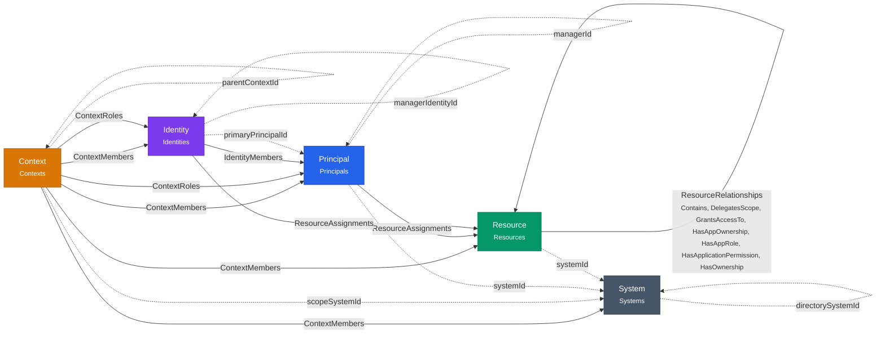
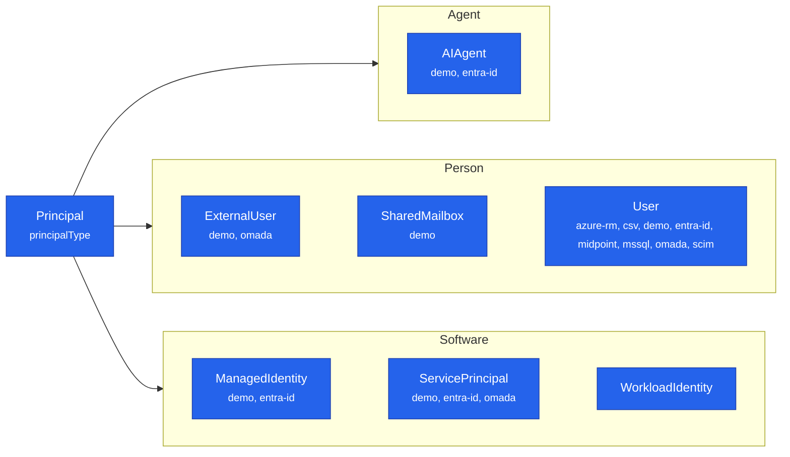
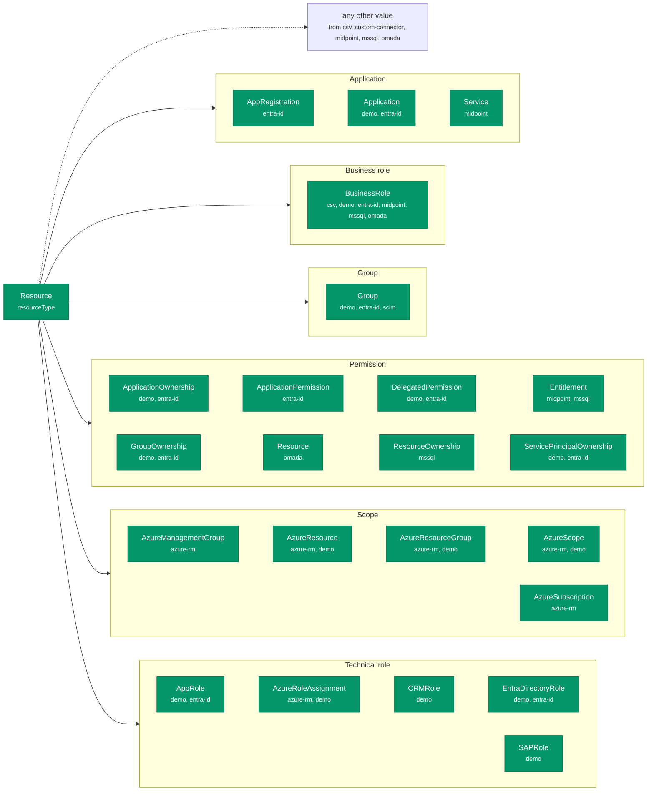
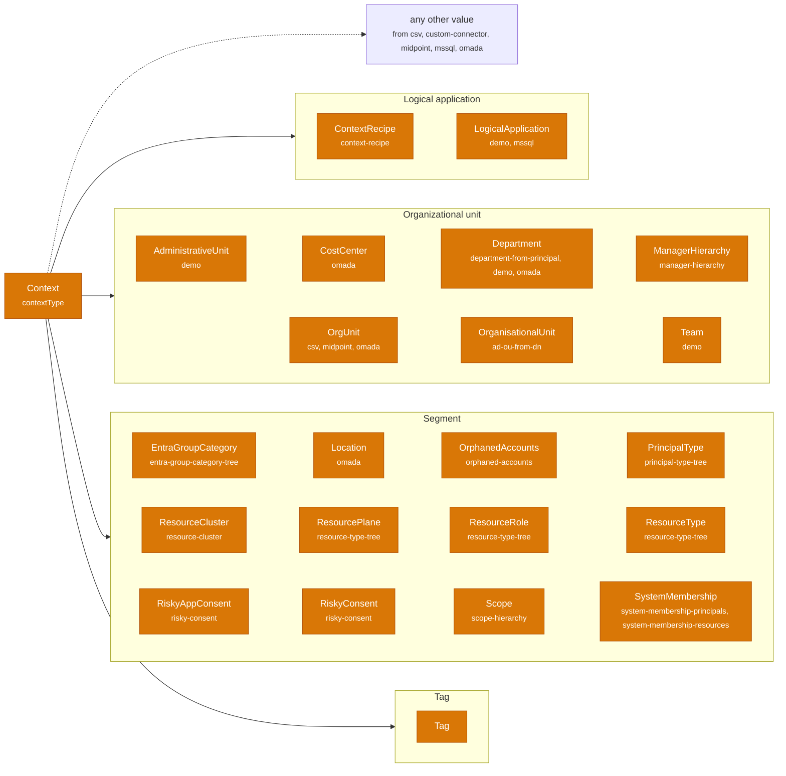
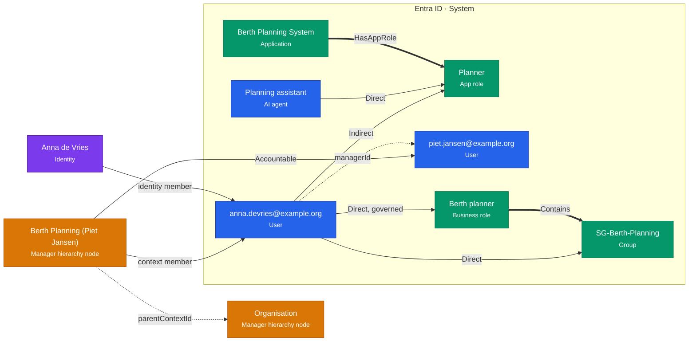

# The Ontology, Visually

Identity Atlas keeps its data in PostgreSQL tables. The **ontology** describes what that data
*means*: which kinds of things exist (an account, a group, a person, a team), how they may be
connected, and which values a field may hold. It is the grammar of the data model, written in a
standard format that other tools can read.

This page shows what that looks like: first the overall picture, then one small team as real data,
then a few lines of the schema file itself.

!!! tip "Download the schema file"
    The ontology is one file, **[`core.ttl`](https://raw.githubusercontent.com/Fortigi/IdentityAtlas/main/ontology/core.ttl)**
    ([view on GitHub](https://github.com/Fortigi/IdentityAtlas/blob/main/ontology/core.ttl)). It is
    written in **Turtle**, the readable text format for RDF, and uses the **OWL 2** vocabulary for
    classes and properties. Protégé, WebVOWL, Apache Jena, rdflib and any other RDF/OWL tool can open
    it; see [Open it in a tool](#open-it-in-a-tool).

    The worked example on this page is a file too:
    **[`examples/team.ttl`](https://raw.githubusercontent.com/Fortigi/IdentityAtlas/main/ontology/examples/team.ttl)**.

---

## The big picture

Everything in Identity Atlas is one of five kinds of **node**, connected by five kinds of **edge**.
A solid arrow is an edge table: a row in it connects two nodes, and carries fields of its own (an
assignment has an `assignmentType`, for example). A dotted arrow is a plain reference from one node
to another (a column such as `managerId`).

<!-- BEGIN GENERATED: ontology core-overview -->

<!-- END GENERATED: ontology core-overview -->

| Node | What it is |
|---|---|
| **System** | A source the data came from: Entra ID, Omada, a SQL database, a CSV file. |
| **Principal** | An *account* in one system: a user, a service principal, a managed identity, an AI agent, a guest. |
| **Resource** | Anything that gives access: a group, an app role, a directory role, a permission — and also a business role. |
| **Identity** | A real *person*, who may have accounts in several systems. |
| **Context** | A grouping of one kind of node: a team, a department, an OU, a tag, a cluster. Contexts form trees. |

Each kind has **types** below it. A Principal is a `User`, an `AIAgent`, a `ServicePrincipal` …; a
Resource is a `Group`, an `AppRole`, a `BusinessRole` …; a Context is a `ManagerHierarchy` node, a
`Department`, a `Tag` …. The next section shows them all.

---

## The types

Each kind of node has **types**: a value in its type column (`principalType`, `resourceType`,
`contextType`) that says what sort of account, resource or grouping a row is. Above the types sit
14 **templates**: three kinds of account (Person, Software, Agent), seven kinds of resource (Group,
TechnicalRole, Permission, Application, Scope, BusinessRole, Other) and four kinds of grouping
(OrganizationalUnit, LogicalApplication, Tag, Segment). The diagrams below
show every type the ontology defines, grouped by its **template**: the level at which Identity Atlas
reasons about it. The type is the source's own word; the template says what the product does with
it. The small text under a type names the crawlers and plugins that write it.

### Account types (Principal)

`principalType` is a **closed list**: the ingest accepts only these values. Crawlers that map types
from their source (Omada, midPoint, SCIM, CSV, SQL) map onto this list. The template says what kind
of actor an account is. *Who answers for it* is a second axis, **accountability**: Personal, Shared or
Autonomous, a property of each account with a default per type. An AI agent can be any of the three
(a personal assistant, a team assistant, an agent on its own permissions), so its default is unknown
until the source, an Owner or Sponsor link, or a person settles it.

<!-- BEGIN GENERATED: ontology types-principal -->

<!-- END GENERATED: ontology types-principal -->

### Resource types (Resource)

`resourceType` is an **open list**: any value is accepted, because every system names its own kinds
of access. Defined here are the values Identity Atlas itself writes or relies on. The dotted arrow
names the crawlers that also pass values through from their source data or configuration.

Owning a group is a right in the target system, so it is a **Permission** of the *control* kind: a
right over another object, which it names through the `HasOwnership` link from that object. Holding
it never makes the holder a member of what it controls. That is how owner and member of one group
stay two rows of the same group in the matrix, each held `Direct`, `Indirect` or `Eligible`.

<!-- BEGIN GENERATED: ontology types-resource -->

<!-- END GENERATED: ontology types-resource -->

### Grouping types (Context)

`contextType` is an open list too, and since 2.1.0 every row also carries its template in
`contextCategory`. A context groups one kind of node; the
[Core Model Reference](../reference/core-model.md#contexts) lists which kind each type groups.
`OrgUnit` (synced from an IGA or HR source, grouping persons) and `OrganisationalUnit` (derived by a
plugin from accounts' AD distinguished names) are two values under the same template. A tree's root
is simply a context without a parent, not a type of its own.

An organizational unit or a logical application can say **who answers for it**: one *Accountable*
(its manager or owner) and any number of *Responsible* people, each an account or a person. That is a
link from the grouping to the person (`ContextRoles`), never access: nobody gains anything by being
accountable for a team. Two org units can be two sides of one unit, the persons and the resources
that belong to them, linked as two variants of one unit by `SameUnitAs`.

<!-- BEGIN GENERATED: ontology types-context -->

<!-- END GENERATED: ontology types-context -->

Every type, with its description, is in the tables of the [Core Model Reference](../reference/core-model.md).

---

## One team, as data

The picture below is a small, fictional team: Anna works for Piet. Anna has an account in Entra ID,
holds a business role, and through a group has access to an app role. An AI agent holds that same app
role directly. The manager-hierarchy plugin has put Anna in Piet's team.

<!-- BEGIN GENERATED: ontology example-team -->

<!-- END GENERATED: ontology example-team -->

How to read it:

- **Colour = kind of node**: purple a person (Identity), blue an account (Principal), green something
  that gives access (Resource), orange a grouping (Context). The grey box is the system the accounts
  and resources come from. The small text under each name is its **type**.
- **A solid arrow labelled `Direct` / `Indirect`** is an assignment: who holds what, and how. Anna holds
  the business role *Direct* and *governed* (an approved request); she has the app role *Indirect*,
  because it comes through her group.
- **A thick arrow** is a relationship between two resources: the business role `Contains` the group,
  the application `HasAppRole` the app role.
- **A dotted arrow** is a reference: Anna's account names Piet's as its `managerId`; Piet's team sits
  below the organisation root (`parentContextId`).
- **Anna (the person) and anna.devries@example.org (the account) are two different things.** The
  person can have more accounts in other systems; the `identity member` arrow links them.
- **Piet answers for the team.** The `Accountable` arrow is a context role: the manager-hierarchy
  plugin states who is accountable for each node, and an analyst can add who is responsible. It is a
  link from the team to the person, not access; see
  [Contexts and the manager hierarchy](../architecture/core-ontology.md#contexts-and-the-manager-hierarchy-as-implemented).

### The same team, as the file says it

This is the complete example file. Every word after `ia:` is a term from the ontology. Each block
describes one thing: its type after `a`, then its fields.

```turtle
--8<-- "ontology/examples/team.ttl"
```

---

## What the schema file says

The ontology itself is written the same way, but it describes the *kinds* of things instead of the
things. A few excerpts, quoted straight from `core.ttl`:

**A kind of node.** `ia:Principal` is a class. It is stored in the `Principals` table, and its
`principalType` column says which subtype a row is:

```turtle
--8<-- "ontology/core.ttl:principal"
```

**A type below it.** An AI agent is a Principal whose `principalType` is `AIAgent`:

```turtle
--8<-- "ontology/core.ttl:ai-agent"
```

**A context type**, with the plugin that makes it and the kind of node it groups:

```turtle
--8<-- "ontology/core.ttl:manager-hierarchy"
```

**A relationship type** between two resources, and which classes it connects:

```turtle
--8<-- "ontology/core.ttl:has-app-role"
```

**A closed list of values.** An assignment is always one of exactly three:

```turtle
--8<-- "ontology/core.ttl:assignment-type"
```

Every term carries a label and a description; the [Core Model Reference](../reference/core-model.md)
lists them all as tables, generated from this same file.

---

## One way of holding

The model separates *what exists* (the types and templates above), *how things relate* (the
relationship types) and *who holds what*. The first two may grow. The third never does: an account
reaches a resource only through an assignment, held **Direct**, **Indirect** or **Eligible**. A new kind
of right, such as owning a group, is a new resource plus a relationship to the object it is about,
never a new way of holding. That rule is what keeps every matrix cell to three values while the
ontology grows; [Core Ontology](../architecture/core-ontology.md#three-layers-one-way-of-holding)
has the full table of concepts and where each one lives.

Activity uploaded on a context — hours from a time registration, events from an audit log — is
**evidence** (`ia:Activity`), kept beside the graph: it is not a holding and it does not make anyone
a member. It can only suggest a member review.

---

## How it stays true

A description is only useful if it matches the application. Three things keep it that way:

- **CI compares the ontology with the code.** If a developer adds a relationship type, a principal
  type, a column, a context type or an allowed value without describing it, the build fails. It also
  fails the other way round, when the ontology describes something the code does not do.
- **CI compares it with the database.** A database migrated from scratch must have exactly the
  columns and allowed values the ontology describes.
- **The pictures on this page and the reference page are generated** from the ontology, and the
  example file is validated against it. Nobody draws them by hand, so they cannot drift.

The details, and what is deliberately *not* checked, are on [Core Ontology](../architecture/core-ontology.md).
How to change the model: [Maintaining the Core Ontology](../contributing/maintaining-the-ontology.md).

---

## Open it in a tool

- **Protégé** (free desktop editor, [protege.stanford.edu](https://protege.stanford.edu/)): *File →
  Open from URL*, paste the `core.ttl` link above. The *Entities* tab shows the class tree (Node →
  Principal → AIAgent …) and every property with its domain and range. The *OntoGraf* tab draws it.
- **WebVOWL** (in the browser, [service.tib.eu/webvowl](https://service.tib.eu/webvowl/)): download
  `core.ttl`, then *Ontology → Select ontology file* to see an interactive graph of the classes.
- **Python** (rdflib):

    ```python
    from rdflib import Graph
    g = Graph().parse("https://raw.githubusercontent.com/Fortigi/IdentityAtlas/main/ontology/core.ttl")
    for cls in g.query("""
        PREFIX ia: <https://identityatlas.io/ontology#>
        PREFIX rdfs: <http://www.w3.org/2000/01/rdf-schema#>
        SELECT ?type WHERE { ?c rdfs:subClassOf ia:Principal ; ia:typeValue ?type }"""):
        print(cls.type)          # User, ServicePrincipal, AIAgent, …
    ```

The namespace `https://identityatlas.io/ontology#` is an identifier, not a web page: opening it in a
browser does not return the file. Use the download links above.
