# Core Model Reference

!!! info "Generated page"
    Generated from [`ontology/core.ttl`](https://github.com/Fortigi/IdentityAtlas/blob/main/ontology/core.ttl) by `npm run ontology:generate` in `app/api`.
    Do not edit it by hand: CI fails when it differs from the ontology. How to change the model:
    [Maintaining the Core Ontology](../contributing/maintaining-the-ontology.md).

Ontology `https://identityatlas.io/ontology`, version `2.4.0`. Namespace `https://identityatlas.io/ontology#` (prefix `ia:`).
Download the Turtle file for Protégé, a triple store or any RDF/OWL tool: [core.ttl](https://raw.githubusercontent.com/Fortigi/IdentityAtlas/main/ontology/core.ttl).

A column is identified by the property of the same name: `Principals.accountEnabled` is
`ia:accountEnabled` (`https://identityatlas.io/ontology#accountEnabled`). One property serves every core table
that has a column of that name; its `rdfs:domain` lists them. Why the model looks like this, and what is not
in it: [Core Ontology](../architecture/core-ontology.md).

## Type hierarchy and relationship types

```mermaid
classDiagram
    direction LR
    class AIAgent
    class AccessPermission
    class ActivityContext
    class AdministrativeUnitContext
    class Agent
    class AppRegistration
    class AppRole
    class Application
    class ApplicationOwnership
    class ApplicationPermission
    class AzureManagementGroup
    class AzureResource
    class AzureResourceGroup
    class AzureRoleAssignment
    class AzureScope
    class AzureSubscription
    class BusinessRole
    class CRMRole
    class Context
    class ContextRecipeContext
    class ControlPermission
    class CostCenterContext
    class DelegatedPermission
    class DepartmentContext
    class DutyContext
    class Entitlement
    class EntraDirectoryRole
    class EntraGroupCategoryContext
    class ExpertiseContext
    class ExternalUser
    class Group
    class GroupOwnership
    class Identity
    class LocationContext
    class LogicalApplicationContext
    class ManagedIdentity
    class ManagerHierarchyContext
    class OrgUnitContext
    class OrganisationalUnitContext
    class OrganizationalUnit
    class OrphanedAccountsContext
    class Other
    class Permission
    class Person
    class Principal
    class PrincipalTypeContext
    class Resource
    class ResourceClusterContext
    class ResourceOwnership
    class ResourcePlaneContext
    class ResourceRoleContext
    class ResourceTypeContext
    class RiskyAppConsentContext
    class RiskyConsentContext
    class SAPRole
    class Scope
    class ScopeContext
    class Segment
    class Service
    class ServicePrincipal
    class ServicePrincipalOwnership
    class SharedMailbox
    class Software
    class System
    class SystemMembershipContext
    class TagContext
    class TeamContext
    class TechnicalRole
    class UntypedResource
    class User
    class WorkloadIdentity
    Agent <|-- AIAgent
    Permission <|-- AccessPermission
    TagContext <|-- ActivityContext
    OrganizationalUnit <|-- AdministrativeUnitContext
    Principal <|-- Agent
    Application <|-- AppRegistration
    TechnicalRole <|-- AppRole
    Resource <|-- Application
    ControlPermission <|-- ApplicationOwnership
    AccessPermission <|-- ApplicationPermission
    Scope <|-- AzureManagementGroup
    Scope <|-- AzureResource
    Scope <|-- AzureResourceGroup
    TechnicalRole <|-- AzureRoleAssignment
    Scope <|-- AzureScope
    Scope <|-- AzureSubscription
    Resource <|-- BusinessRole
    TechnicalRole <|-- CRMRole
    LogicalApplicationContext <|-- ContextRecipeContext
    Permission <|-- ControlPermission
    OrganizationalUnit <|-- CostCenterContext
    AccessPermission <|-- DelegatedPermission
    OrganizationalUnit <|-- DepartmentContext
    TagContext <|-- DutyContext
    AccessPermission <|-- Entitlement
    TechnicalRole <|-- EntraDirectoryRole
    Segment <|-- EntraGroupCategoryContext
    TagContext <|-- ExpertiseContext
    Person <|-- ExternalUser
    Resource <|-- Group
    ControlPermission <|-- GroupOwnership
    Segment <|-- LocationContext
    Context <|-- LogicalApplicationContext
    Software <|-- ManagedIdentity
    OrganizationalUnit <|-- ManagerHierarchyContext
    OrganizationalUnit <|-- OrgUnitContext
    OrganizationalUnit <|-- OrganisationalUnitContext
    Context <|-- OrganizationalUnit
    Segment <|-- OrphanedAccountsContext
    Resource <|-- Other
    Resource <|-- Permission
    Principal <|-- Person
    Segment <|-- PrincipalTypeContext
    Segment <|-- ResourceClusterContext
    ControlPermission <|-- ResourceOwnership
    Segment <|-- ResourcePlaneContext
    Segment <|-- ResourceRoleContext
    Segment <|-- ResourceTypeContext
    Segment <|-- RiskyAppConsentContext
    Segment <|-- RiskyConsentContext
    TechnicalRole <|-- SAPRole
    Resource <|-- Scope
    Segment <|-- ScopeContext
    Context <|-- Segment
    Application <|-- Service
    Software <|-- ServicePrincipal
    ControlPermission <|-- ServicePrincipalOwnership
    Person <|-- SharedMailbox
    Principal <|-- Software
    Segment <|-- SystemMembershipContext
    Context <|-- TagContext
    OrganizationalUnit <|-- TeamContext
    Resource <|-- TechnicalRole
    AccessPermission <|-- UntypedResource
    Person <|-- User
    Software <|-- WorkloadIdentity
    Resource --> Resource : Contains
    Application --> DelegatedPermission : DelegatesScope
    Resource --> Resource : GrantsAccessTo
    Application --> ServicePrincipalOwnership : HasAppOwnership
    Application --> ApplicationOwnership : HasAppOwnership
    Application --> AppRole : HasAppRole
    Application --> ApplicationPermission : HasApplicationPermission
    Resource --> GroupOwnership : HasOwnership
    Resource --> ResourceOwnership : HasOwnership
    Principal --> Principal : Owner
    Context --> Context : SameUnitAs
    Principal --> Principal : Sponsor
```

<!-- BEGIN GENERATED: ontology core-classes -->

<!-- END GENERATED: ontology core-classes -->

## Node tables

### Contexts

`ia:Context` · Node table · A grouping of one kind of entity — a department, an OU, a tag, a cluster, a logical application. Synced, generated by a plugin, or manual. contextType is an open vocabulary; the values the application itself knows are its subclasses. A child context has the same targetType as its parent (the routes and plugins keep this, the database does not enforce it), and the tree is acyclic (enforced at commit by trg_Contexts_reject_cycle).

Written by the ingest API as `contexts`.

Identifier: `id` (uuid) — the instance IRI, not a property.

`contextType` is an open vocabulary — any value is accepted. These are the values Identity Atlas itself relies on:

| Value | Class | Template | Groups | Made by | Meaning |
|---|---|---|---|---|---|
| `Activity` | `ia:ActivityContext` | Tag | Identity | application code | A business activity people perform (performsActivity), the object of an activity claim. Manual, under one root Activities (extendedAttributes.knowledgeRoot); created when a claim naming it is confirmed (Authorization workbench). |
| `AdministrativeUnit` | `ia:AdministrativeUnitContext` | Organizational unit | Principal | crawler `demo` | An Entra administrative unit. Only the demo dataset emits it; the Entra crawler does not sync administrative units. |
| `ContextRecipe` | `ia:ContextRecipeContext` | Logical application | Resource | plugin `context-recipe` | Resources matched by a recipe built in the context assistant, plus the ones pinned by hand. The type says how the context was built; its template (contextCategory) is chosen at save time, an application being the common case. |
| `CostCenter` | `ia:CostCenterContext` | Organizational unit | Identity | crawler `omada` | A cost center synced from Omada, grouping persons: an org dimension a manager recognises, so an organizational unit. |
| `Department` | `ia:DepartmentContext` | Organizational unit | Identity, Principal | plugin `department-from-principal`; crawlers `demo`, `omada` | One flat context per distinct Principals.department value (externalId 'dept:<value>'), without hierarchy. The Omada crawler syncs departments of persons under the same value, and the demo dataset writes a department tree of accounts. |
| `Duty` | `ia:DutyContext` | Tag | Identity | application code | A duty people hold beside their daily work (holdsResponsibility: works council, fire warden, a project role), the object of a duty claim. Manual, under one root Duties. |
| `EntraGroupCategory` | `ia:EntraGroupCategoryContext` | Segment | Resource | plugin `entra-group-category-tree` | The Entra groups of one category (security, Microsoft 365, dynamic …). |
| `Expertise` | `ia:ExpertiseContext` | Tag | Identity | application code | A domain people know (hasExpertise), the object of an expertise claim. Manual, under one root Expertise. |
| `Location` | `ia:LocationContext` | Segment | Identity | crawler `omada` | A work location synced from Omada, grouping persons. |
| `LogicalApplication` | `ia:LogicalApplicationContext` | Logical application | Resource | crawlers `demo`, `mssql` | An application as the business knows it, grouping the technical resources (entitlements, roles, groups) that belong to it. The SQL connector's IdentityIQ preset loads these from the application list. |
| `ManagerHierarchy` | `ia:ManagerHierarchyContext` | Organizational unit | Principal | plugin `manager-hierarchy` | One generated context per manager of one system's accounts, plus a synthetic root (externalId 'root'). The manager is recorded only in externalId, which holds the manager's Principal id — there is no manager column or member role. Members are the manager's direct reports (Principals.managerId, overridden per account by ManagerHierarchyOverrides); the manager is a member of their own manager's node, not of their own. parentContextId is the node of the manager's own manager, else the root. Accounts with no manager that manage nobody are members of the root; a top-level manager is a member of no node. A managerId that points at no account of the system still becomes a node, named 'Unknown'. A reporting cycle, a self-reference included, leaves a node without a parent: the runner refuses the link that would close the cycle. |
| `OrgUnit` | `ia:OrgUnitContext` | Organizational unit | Identity | crawlers `csv`, `midpoint`, `omada` | An organisational unit synced from an IGA or HR source, grouping persons; nested like the source's org tree. The default context type of the Omada, CSV and midPoint crawlers. Not the same value as the OrganisationalUnit the ad-ou-from-dn plugin derives from accounts. |
| `OrganisationalUnit` | `ia:OrganisationalUnitContext` | Organizational unit | Principal | plugin `ad-ou-from-dn` | An Active Directory OU derived from the accounts' distinguished names, nested like the directory. Crawlers that sync org units (Omada, CSV, midPoint) store 'OrgUnit' instead — a different value the ontology does not define. |
| `OrphanedAccounts` | `ia:OrphanedAccountsContext` | Segment | Principal | plugin `orphaned-accounts` | Accounts that are not linked to any identity. |
| `PrincipalType` | `ia:PrincipalTypeContext` | Segment | Principal | plugin `principal-type-tree` | The accounts of one principalType. |
| `ResourceCluster` | `ia:ResourceClusterContext` | Segment | Resource | plugin `resource-cluster` | Resources whose names cluster together. |
| `ResourcePlane` | `ia:ResourcePlaneContext` | Segment | Resource | plugin `resource-type-tree` | Control or data plane below a resource type group. |
| `ResourceRole` | `ia:ResourceRoleContext` | Segment | Resource | plugin `resource-type-tree` | One role name below a resource plane. |
| `ResourceType` | `ia:ResourceTypeContext` | Segment | Resource | plugin `resource-type-tree` | The resources of one resourceType. |
| `RiskyAppConsent` | `ia:RiskyAppConsentContext` | Segment | Resource | plugin `risky-consent` | Applications flagged as malicious (threat feed) or suspicious (heuristics). |
| `RiskyConsent` | `ia:RiskyConsentContext` | Segment | Resource | plugin `risky-consent` | Granted permissions of one risk tier (High, Medium, Low). |
| `Scope` | `ia:ScopeContext` | Segment | Resource | plugin `scope-hierarchy` | A node of the scope-hierarchy tree, the root included: one Azure scope (management group, subscription, resource group). The resource's own type is in extendedAttributes.resourceType. |
| `SystemMembership` | `ia:SystemMembershipContext` | Segment | Principal, Resource | plugin `system-membership-principals`, `system-membership-resources` | The accounts, or the resources, loaded from one system. |
| `Tag` | `ia:TagContext` | Tag | Identity, Principal, Resource | application code | A manual label (variant 'manual') that the tags API reads and writes. One root per targetType holds them, itself a Tag marked extendedAttributes.tagRoot = true, which the tags API and the GraphTags view leave out. |
| `Team` | `ia:TeamContext` | Organizational unit | Principal, Resource | crawler `demo` | A team below a department, as its people or as the resources it administers (the two linked by sameUnitAs). Only the demo dataset emits it. |

Other values arrive from the source data or configuration of: `csv`, `custom-connector`, `midpoint`, `mssql`, `omada`.

| Column | Property | SQL type | Values / references | Description |
|---|---|---|---|---|
| `contextCategory` | `ia:contextCategory` | text | `OrganizationalUnit`, `LogicalApplication`, `Tag`, `Segment` | The template this context falls under. NULL for a synced value nobody has placed yet. |
| `contextType` | `ia:contextType` | text | open vocabulary | What kind of grouping this is (Department, OrgUnit, Tag, Cluster, LogicalApplication, …). An open vocabulary. |
| `createdAt` | `ia:createdAt` | timestamp with time zone |  | When the context row was created. |
| `createdByUser` | `ia:createdByUser` | text |  | The analyst who created a manual context. |
| `description` | `ia:description` | text |  | Free-text description. |
| `directAssignmentCount` | `ia:directAssignmentCount` | integer |  | Stored count of Direct (resource, holder) pairs over the resources in this context. |
| `directMemberCount` | `ia:directMemberCount` | integer |  | Stored count of direct members. |
| `displayName` | `ia:displayName` | text |  | Human-readable name. On IdentityMembers a copy of the account name. |
| `eligibleAssignmentCount` | `ia:eligibleAssignmentCount` | integer |  | Stored count of Eligible (resource, holder) pairs over the resources in this context. |
| `extendedAttributes` | `ia:extendedAttributes` | jsonb |  | Source-specific attributes that have no column of their own. |
| `externalId` | `ia:externalId` | text |  | The object's id in its source system. |
| `holderCount` | `ia:holderCount` | integer |  | Stored count of distinct holders over the resources in this context. |
| `indirectAssignmentCount` | `ia:indirectAssignmentCount` | integer |  | Stored count of Indirect (resource, holder) pairs over the resources in this context. |
| `lastCalculatedAt` | `ia:lastCalculatedAt` | timestamp with time zone |  | When the stored counts were last recalculated. |
| `ownerUserId` | `ia:ownerUserId` | text |  | Whatever the source calls the owner of the grouping (free text, resolved to a principal for display). |
| `parentContextId` | `ia:parentContextId` | uuid | → Contexts | The parent context in the tree. Ingest alias: `parentExternalId`. |
| `resourceCount` | `ia:resourceCount` | integer |  | Stored count of resources in this context. |
| `scopeSystemId` | `ia:scopeSystemId` | integer | → Systems | The system a synced or generated context is scoped to. |
| `sourceAlgorithmId` | `ia:sourceAlgorithmId` | uuid |  | The context-algorithm (ContextAlgorithms.id) that generated the context. ContextAlgorithms is outside the core model. |
| `sourceInstanceKey` | `ia:sourceInstanceKey` | text |  | Distinguishes several trees generated by one plugin on one system. |
| `sourceRunId` | `ia:sourceRunId` | uuid |  | The plugin run that generated the context. |
| `targetType` | `ia:targetType` | text | `Identity`, `Resource`, `Principal`, `System` | Which kind of node the context groups. |
| `totalMemberCount` | `ia:totalMemberCount` | integer |  | Stored count of members including sub-contexts. |
| `updatedAt` | `ia:updatedAt` | timestamp with time zone |  | When the row was last written by the ingest (full-sync reconcile cutoff). |
| `userRenamed` | `ia:userRenamed` | boolean |  | An analyst renamed this generated context; re-runs keep the name. |
| `userReparented` | `ia:userReparented` | boolean |  | An analyst moved this generated context; re-runs keep the placement. |
| `variant` | `ia:variant` | text | `synced`, `generated`, `manual` | How the context came to exist. |

### Identities

`ia:Identity` · Node table · A real person, aggregated from one or more accounts (principals) through IdentityMembers.

Written by the ingest API as `identities`.

Identifier: `id` (uuid) — the instance IRI, not a property.

| Column | Property | SQL type | Values / references | Description |
|---|---|---|---|---|
| `accountCount` | `ia:accountCount` | integer |  | Number of accounts linked to this person. |
| `accountTypes` | `ia:accountTypes` | jsonb |  | The account categories this person holds. |
| `analystNotes` | `ia:analystNotes` | text |  | Free-text analyst notes on the person. |
| `analystVerified` | `ia:analystVerified` | boolean |  | An analyst has verified this person. |
| `city` | `ia:city` | text |  | The person's city. |
| `companyName` | `ia:companyName` | text |  | Company name. |
| `country` | `ia:country` | text |  | The person's country. |
| `department` | `ia:department` | text |  | Department name as a plain attribute (organisational placement itself is a Context). |
| `displayName` | `ia:displayName` | text |  | Human-readable name. On IdentityMembers a copy of the account name. |
| `email` | `ia:email` | text |  | E-mail address. |
| `employeeId` | `ia:employeeId` | text |  | Employee number. |
| `extendedAttributes` | `ia:extendedAttributes` | jsonb |  | Source-specific attributes that have no column of their own. |
| `givenName` | `ia:givenName` | text |  | Given name. |
| `hrAccountId` | `ia:hrAccountId` | text |  | The HR record id the person is anchored on. |
| `isHrAnchored` | `ia:isHrAnchored` | boolean |  | The person is anchored on an HR record. |
| `jobTitle` | `ia:jobTitle` | text |  | Job title. |
| `linkConfidence` | `ia:linkConfidence` | integer |  | Account Linking confidence score; NULL for crawler-sourced links. |
| `linkSignals` | `ia:linkSignals` | jsonb |  | The signals Account Linking matched on. |
| `linkedAt` | `ia:linkedAt` | timestamp with time zone |  | When Account Linking last linked the person. |
| `managerIdentityId` | `ia:managerIdentityId` | uuid | → Identities | The manager as a PERSON. Ingest alias: `managerIdentityExternalId`. |
| `officeLocation` | `ia:officeLocation` | text |  | The person's office. |
| `orphanStatus` | `ia:orphanStatus` | text |  | **Retired.** Orphan-ness is the generated Orphaned Accounts context now; the column is kept in the schema for compatibility. |
| `primaryPrincipalId` | `ia:primaryPrincipalId` | uuid | → Principals | The person's primary account. |
| `surname` | `ia:surname` | text |  | Surname. |

### Principals

`ia:Principal` · Node table · An account in a source system: a user, service principal, managed identity, AI agent, guest, shared mailbox …

Written by the ingest API as `principals`.

Identifier: `id` (uuid) — the instance IRI, not a property.

`principalType` accepts exactly these values:

| Value | Class | Template | Made by | Meaning |
|---|---|---|---|---|
| `AIAgent` | `ia:AIAgent` | Agent | crawlers `demo`, `entra-id` | An AI agent (Copilot Studio, Azure OpenAI, a custom bot) that holds access as its own account. |
| `ExternalUser` | `ia:ExternalUser` | Person | crawlers `demo`, `omada` | A guest / B2B account from another organisation. |
| `ManagedIdentity` | `ia:ManagedIdentity` | Software | crawlers `demo`, `entra-id` | A system- or user-assigned identity attached to a cloud resource. |
| `ServicePrincipal` | `ia:ServicePrincipal` | Software | crawlers `demo`, `entra-id`, `omada` | The service principal of an application registration. |
| `SharedMailbox` | `ia:SharedMailbox` | Person | crawler `demo` | A shared, room or equipment mailbox account. Accepted from CSV, SQL, SCIM and midPoint sources; of the built-in sources only the demo dataset writes it. |
| `User` | `ia:User` | Person | crawlers `azure-rm`, `csv`, `demo`, `entra-id`, `midpoint`, `mssql`, `omada`, `scim` | An interactive human user account. |
| `WorkloadIdentity` | `ia:WorkloadIdentity` | Software | no built-in source | A federated-credential identity used by a workload (a pipeline, a Kubernetes service account). Accepted from CSV, SQL, SCIM and midPoint sources; the Entra crawler deliberately does not classify accounts this way. |

Mapped onto this list from the source data or configuration by: `csv`, `custom-connector`, `midpoint`, `mssql`, `omada`, `scim`.

| Column | Property | SQL type | Values / references | Description |
|---|---|---|---|---|
| `accountEnabled` | `ia:accountEnabled` | boolean |  | Whether the account can sign in. On IdentityMembers a copy taken when the link was made. |
| `companyName` | `ia:companyName` | text |  | Company name. |
| `createdDateTime` | `ia:createdDateTime` | timestamp with time zone |  | When the object was created in the source (PrincipalRelationships: when the row was created). |
| `deletedAt` | `ia:deletedAt` | timestamp with time zone |  | Soft-delete tombstone: set when the source stopped reporting the row; NULL while live. |
| `department` | `ia:department` | text |  | Department name as a plain attribute (organisational placement itself is a Context). |
| `displayName` | `ia:displayName` | text |  | Human-readable name. On IdentityMembers a copy of the account name. |
| `email` | `ia:email` | text |  | E-mail address. |
| `employeeId` | `ia:employeeId` | text |  | Employee number. |
| `extendedAttributes` | `ia:extendedAttributes` | jsonb |  | Source-specific attributes that have no column of their own. |
| `externalId` | `ia:externalId` | text |  | The object's id in its source system. |
| `givenName` | `ia:givenName` | text |  | Given name. |
| `jobTitle` | `ia:jobTitle` | text |  | Job title. |
| `managerId` | `ia:managerId` | uuid | → Principals | The manager's ACCOUNT. Ingest alias: `managerExternalId`. |
| `photo` | `ia:photo` | bytea |  | Profile photo (sent base64 to the ingest). |
| `photoContentType` | `ia:photoContentType` | text |  | MIME type of the photo. |
| `photoFetchedAt` | `ia:photoFetchedAt` | timestamp with time zone |  | When the photo was last fetched; set with a NULL photo means "has none". |
| `principalType` | `ia:principalType` | text | `User`, `ServicePrincipal`, `ManagedIdentity`, `WorkloadIdentity`, `AIAgent`, `ExternalUser`, `SharedMailbox` | The kind of account. On Principals it selects the subclass; on ResourceAssignments it is a denormalised copy of the holder's type. |
| `riskScore` | `ia:riskScore` | integer |  | Latest risk score, denormalised from RiskScores. |
| `riskTier` | `ia:riskTier` | text |  | Latest risk tier, denormalised from RiskScores. |
| `surname` | `ia:surname` | text |  | Surname. |
| `systemId` | `ia:systemId` | integer | → Systems | The system that sourced the row. |
| `updatedAt` | `ia:updatedAt` | timestamp with time zone |  | When the row was last written by the ingest (full-sync reconcile cutoff). |

### Resources

`ia:Resource` · Node table · Anything that grants access — a group, a directory role, an app role, a permission — and also a business role (governance construct).

Written by the ingest API as `resources`.

Identifier: `id` (uuid) — the instance IRI, not a property.

`resourceType` is an open vocabulary — any value is accepted. These are the values Identity Atlas itself relies on:

| Value | Class | Template | Made by | Meaning |
|---|---|---|---|---|
| `AppRegistration` | `ia:AppRegistration` | Application | crawler `entra-id` | An app registration (id = application object id; appId joins it to its service principal). Grants nothing and has no assignments; carries the app's security set-up (credential metadata, redirect URIs, required resource access, federated credentials). |
| `AppRole` | `ia:AppRole` | Technical role | crawlers `demo`, `entra-id` | One app role of an application (one resource per application + appRoleId). |
| `Application` | `ia:Application` | Application | crawlers `demo`, `entra-id` | An enterprise application (service principal) as a resource. Grants nothing by itself; parent of its app roles and permissions. |
| `ApplicationOwnership` | `ia:ApplicationOwnership` | Permission | crawlers `demo`, `entra-id` | The owners of an app registration — they can add a credential and act as the app. |
| `ApplicationPermission` | `ia:ApplicationPermission` | Permission | crawler `entra-id` | One app-only (admin-consented) permission a service principal holds on another API. |
| `AzureManagementGroup` | `ia:AzureManagementGroup` | Scope | crawler `azure-rm` | An Azure management group; Contains the management groups and subscriptions below it. |
| `AzureResource` | `ia:AzureResource` | Scope | crawlers `azure-rm`, `demo` | One Azure resource. Its ARM type (Microsoft.Compute/virtualMachines …) is in extendedAttributes.azureResourceType, not in resourceType. |
| `AzureResourceGroup` | `ia:AzureResourceGroup` | Scope | crawlers `azure-rm`, `demo` | An Azure resource group; Contains its resources. |
| `AzureRoleAssignment` | `ia:AzureRoleAssignment` | Technical role | crawlers `azure-rm`, `demo` | One Azure RBAC role at one scope (role definition + scope); holders have it Direct, or Indirect through a group or an inherited scope. |
| `AzureScope` | `ia:AzureScope` | Scope | crawlers `azure-rm`, `demo` | The tenant root scope ('/') of Azure Resource Manager, above every management group. |
| `AzureSubscription` | `ia:AzureSubscription` | Scope | crawler `azure-rm` | An Azure subscription; Contains its resource groups. |
| `BusinessRole` | `ia:BusinessRole` | Business role | crawlers `csv`, `demo`, `entra-id`, `midpoint`, `mssql`, `omada` | A governance construct (Entra access package, Omada / midPoint business role). Contains the resources it grants; hidden from the matrix by default. |
| `CRMRole` | `ia:CRMRole` | Technical role | crawler `demo` | A role in a CRM system. Only the demo dataset emits it. |
| `DelegatedPermission` | `ia:DelegatedPermission` | Permission | crawlers `demo`, `entra-id` | One OAuth2 delegated scope granted to a client application on an API (one resource per client, API and scope). |
| `Entitlement` | `ia:Entitlement` | Permission | crawlers `midpoint`, `mssql` | A permission in a target application, as an IGA system records it (a midPoint entitlement shadow, an IdentityIQ entitlement). |
| `EntraDirectoryRole` | `ia:EntraDirectoryRole` | Technical role | crawlers `demo`, `entra-id` | One Entra directory role (id = roleDefinitionId); extendedAttributes holds its allowedResourceActions. |
| `Group` | `ia:Group` | Group | crawlers `demo`, `entra-id`, `scim` | A security or Microsoft 365 group. The effective-access engine expands membership through it. |
| `GroupOwnership` | `ia:GroupOwnership` | Permission | crawlers `demo`, `entra-id` | The owners of an Entra group. |
| `Resource` | `ia:UntypedResource` | Permission | crawler `omada` | A resource the source does not classify further. Omada's default for permissions; the source's own type is in extendedAttributes.resourceType. |
| `ResourceOwnership` | `ia:ResourceOwnership` | Permission | crawler `mssql` | The owners of a resource loaded by the SQL connector; the owned resource's own type is in extendedAttributes.ownedResourceType. |
| `SAPRole` | `ia:SAPRole` | Technical role | crawler `demo` | An SAP role. Only the demo dataset emits it; a real SAP source would arrive through CSV or SQL with a value of its own choosing. |
| `Service` | `ia:Service` | Application | crawler `midpoint` | A service (an application or system) as midPoint models it. |
| `ServicePrincipalOwnership` | `ia:ServicePrincipalOwnership` | Permission | crawlers `demo`, `entra-id` | The owners of an enterprise application's service principal. |

Other values arrive from the source data or configuration of: `csv`, `custom-connector`, `midpoint`, `mssql`, `omada`.

| Column | Property | SQL type | Values / references | Description |
|---|---|---|---|---|
| `capabilityId` | `ia:capabilityId` | text |  | Generated from extendedAttributes.capabilityId for the effective-access engine. |
| `catalogId` | `ia:catalogId` | uuid |  | The governance catalog (GovernanceCatalogs.id) a business role belongs to. GovernanceCatalogs is outside the core model. |
| `createdDateTime` | `ia:createdDateTime` | timestamp with time zone |  | When the object was created in the source (PrincipalRelationships: when the row was created). |
| `deletedAt` | `ia:deletedAt` | timestamp with time zone |  | Soft-delete tombstone: set when the source stopped reporting the row; NULL while live. |
| `description` | `ia:description` | text |  | Free-text description. |
| `displayName` | `ia:displayName` | text |  | Human-readable name. On IdentityMembers a copy of the account name. |
| `enabled` | `ia:enabled` | boolean |  | Whether the system or resource is enabled. |
| `extendedAttributes` | `ia:extendedAttributes` | jsonb |  | Source-specific attributes that have no column of their own. |
| `externalId` | `ia:externalId` | text |  | The object's id in its source system. |
| `governanceResource` | `ia:governanceResource` | boolean |  | The resource is a governance construct that governs other access (business roles). |
| `isHidden` | `ia:isHidden` | boolean |  | Hidden from the default views. |
| `mail` | `ia:mail` | text |  | Mail address of a mail-enabled resource. |
| `modifiedDateTime` | `ia:modifiedDateTime` | timestamp with time zone |  | When the object was last modified in the source (PrincipalRelationships: when the row was last modified). |
| `resourceType` | `ia:resourceType` | text | open vocabulary | The kind of resource (open vocabulary). On Resources it selects the subclass; on ResourceAssignments it is a denormalised copy used to partition reconciles. |
| `riskScore` | `ia:riskScore` | integer |  | Latest risk score, denormalised from RiskScores. |
| `riskTier` | `ia:riskTier` | text |  | Latest risk tier, denormalised from RiskScores. |
| `systemId` | `ia:systemId` | integer | → Systems | The system that sourced the row. |
| `targetNodeId` | `ia:targetNodeId` | text |  | Generated from extendedAttributes.targetNodeId: the node a capability resource applies to. |
| `updatedAt` | `ia:updatedAt` | timestamp with time zone |  | When the row was last written by the ingest (full-sync reconcile cutoff). |
| `visibility` | `ia:visibility` | text |  | Visibility as the source reports it (Public / Private for groups). |

### Systems

`ia:System` · Node table · A connected authorization source (Entra ID, Omada, a SQL database, a CSV feed …). Principals, resources and synced contexts belong to one system.

Written by the ingest API as `systems`.

Identifier: `id` (integer) — the instance IRI, not a property.

| Column | Property | SQL type | Values / references | Description |
|---|---|---|---|---|
| `assignmentTypes` | `ia:assignmentTypes` | jsonb |  | **Unused.** Meant to list the assignment types a system emits. Nothing reads or writes it. |
| `description` | `ia:description` | text |  | Free-text description. |
| `directorySystemId` | `ia:directorySystemId` | integer | → Systems | The directory system whose principals this system references but does not own (Azure RM -> Entra ID). |
| `displayName` | `ia:displayName` | text |  | Human-readable name. On IdentityMembers a copy of the account name. |
| `enabled` | `ia:enabled` | boolean |  | Whether the system or resource is enabled. |
| `extendedAttributes` | `ia:extendedAttributes` | jsonb |  | Source-specific attributes that have no column of their own. |
| `lastSyncDateTime` | `ia:lastSyncDateTime` | timestamp with time zone |  | When the system was last synced. |
| `resourceTypes` | `ia:resourceTypes` | jsonb |  | **Unused.** Meant to list the resource types a system emits. Nothing reads or writes it. |
| `syncEnabled` | `ia:syncEnabled` | boolean |  | Whether the system is synced. |
| `systemType` | `ia:systemType` | text |  | The connector kind (EntraID, Omada, CSV, …). Together with tenantId the system key. |
| `tenantId` | `ia:tenantId` | text |  | The tenant / instance the system connects to. |

## Edge tables

### ContextMembers

`ia:ContextMember` · Edge table · Membership of an identity, principal, resource or system in a context. memberType says which table memberId points at.

Written by the ingest API as `context-members`.

Edge: `contextId` → `memberId`.

| Column | Property | SQL type | Values / references | Description |
|---|---|---|---|---|
| `addedAt` | `ia:addedAt` | timestamp with time zone |  | When the member was added. |
| `addedBy` | `ia:addedBy` | text | `sync`, `algorithm`, `analyst`, `sourceOwner` | Who added the member. |
| `contextId` | `ia:contextId` | uuid | → Contexts | The context. Ingest alias: `contextExternalId`. |
| `memberId` | `ia:memberId` | uuid | → Identities / Resources / Principals / Systems | The member; memberType names its table. Ingest alias: `memberExternalId`. |
| `memberType` | `ia:memberType` | text | `Identity`, `Resource`, `Principal`, `System` | Which kind of node memberId is. |

### ContextRelationships

`ia:ContextRelationship` · Edge table · A typed link between two contexts: two variants of one unit (its people, its accounts, its resources).

Identifier: `id` (uuid) — the instance IRI, not a property.

Edge: `contextId` → `relatedContextId`.

`relationshipType` accepts exactly these relationship types:

| Value | Property | From → to | Meaning |
|---|---|---|---|
| `SameUnitAs` | `ia:sameUnitAs` | ia:Context → ia:Context | The two contexts are one unit seen through a different kind of member: Contoso as its people, its accounts, its resources. Symmetric; stored once per pair. Each side still holds one kind of member, and the two hold different kinds. |

| Column | Property | SQL type | Values / references | Description |
|---|---|---|---|---|
| `addedBy` | `ia:addedBy` | text | `sync`, `algorithm`, `analyst`, `sourceOwner` | Who added the member. |
| `contextId` | `ia:contextId` | uuid | → Contexts | The context. Ingest alias: `contextExternalId`. |
| `createdAt` | `ia:createdAt` | timestamp with time zone |  | When the context row was created. |
| `relatedContextId` | `ia:relatedContextId` | uuid | → Contexts | The other context of the link. |
| `relationshipType` | `ia:relationshipType` | text | `SameUnitAs` | The relationship type: one of the ia:typeValue of the properties stored in this edge table. |

### ContextRoles

`ia:ContextRole` · Edge table · Who answers for a context: one account (principalId) or one person (identityId) — exactly one — is Accountable (at most one per context) or Responsible for it. A context→person link, never access: it is not an assignment and grants nothing.

Identifier: `id` (uuid) — the instance IRI, not a property.

Edge: `contextId` → `principalId` or `identityId`.

| Column | Property | SQL type | Values / references | Description |
|---|---|---|---|---|
| `addedBy` | `ia:addedBy` | text | `sync`, `algorithm`, `analyst`, `sourceOwner` | Who added the member. |
| `contextId` | `ia:contextId` | uuid | → Contexts | The context. Ingest alias: `contextExternalId`. |
| `createdAt` | `ia:createdAt` | timestamp with time zone |  | When the context row was created. |
| `identityId` | `ia:identityId` | uuid | → Identities | The person. On ResourceAssignments set instead of principalId for person-level assignments; on ContextInterviews the interviewee, on ContextClaims the person the claim is about, when that is a person. Ingest alias: `identityExternalId`. |
| `principalId` | `ia:principalId` | uuid | → Principals | The account. On ResourceAssignments NULL when identityId is set; on PrincipalRelationships the subject that HAS the owner / sponsor; on ContextInterviews the interviewee, on ContextClaims the account the claim is about. Ingest alias: `principalExternalId`, `userExternalId`. |
| `role` | `ia:role` | text | `Accountable`, `Responsible` | Accountable or Responsible. |
| `sourceClaimId` | `ia:sourceClaimId` | uuid | → ContextClaims | The interview claim this role was confirmed from. NULL for every other role, and once the interview is deleted. |
| `updatedAt` | `ia:updatedAt` | timestamp with time zone |  | When the row was last written by the ingest (full-sync reconcile cutoff). |

### IdentityMembers

`ia:IdentityMember` · Edge table · Links a person (identity) to one of their accounts (principal), from a crawler or from Account Linking.

Written by the ingest API as `identity-members`.

Edge: `identityId` → `principalId`.

| Column | Property | SQL type | Values / references | Description |
|---|---|---|---|---|
| `accountEnabled` | `ia:accountEnabled` | boolean |  | Whether the account can sign in. On IdentityMembers a copy taken when the link was made. |
| `accountType` | `ia:accountType` | text |  | Account category detected by Account Linking (Admin, Guest, Service, Shared, Secondary, …). |
| `accountTypePattern` | `ia:accountTypePattern` | text |  | The naming pattern that classified accountType. |
| `analystOverride` | `ia:analystOverride` | text |  | An analyst's verdict on a link (confirmed / rejected / moved); Account Linking honours it on every run. |
| `displayName` | `ia:displayName` | text |  | Human-readable name. On IdentityMembers a copy of the account name. |
| `hrIndicators` | `ia:hrIndicators` | jsonb |  | Signals that made this account look HR-authoritative. |
| `hrScore` | `ia:hrScore` | integer |  | How strongly this account looks like the HR record. |
| `identityId` | `ia:identityId` | uuid | → Identities | The person. On ResourceAssignments set instead of principalId for person-level assignments; on ContextInterviews the interviewee, on ContextClaims the person the claim is about, when that is a person. Ingest alias: `identityExternalId`. |
| `isHrAuthoritative` | `ia:isHrAuthoritative` | boolean |  | This account is the HR-authoritative one. |
| `isPrimary` | `ia:isPrimary` | boolean |  | This is the person's primary account. |
| `linkConfidence` | `ia:linkConfidence` | integer |  | Account Linking confidence score; NULL for crawler-sourced links. |
| `linkSignals` | `ia:linkSignals` | jsonb |  | The signals Account Linking matched on. |
| `principalId` | `ia:principalId` | uuid | → Principals | The account. On ResourceAssignments NULL when identityId is set; on PrincipalRelationships the subject that HAS the owner / sponsor; on ContextInterviews the interviewee, on ContextClaims the account the claim is about. Ingest alias: `principalExternalId`, `userExternalId`. |

### PrincipalRelationships

`ia:PrincipalRelationship` · Edge table · A responsibility link between two accounts: relatedPrincipalId is the Owner / Sponsor OF principalId.

Written by the ingest API as `principal-relationships`.

Edge: `principalId` → `relatedPrincipalId`.

`relationshipType` accepts exactly these relationship types:

| Value | Property | From → to | Meaning |
|---|---|---|---|
| `Owner` | `ia:owner` | ia:Principal → ia:Principal | The object is an owner of the subject (typically of an AI agent or service principal). |
| `Sponsor` | `ia:sponsor` | ia:Principal → ia:Principal | The object is a sponsor of the subject (typically of a guest account). |

| Column | Property | SQL type | Values / references | Description |
|---|---|---|---|---|
| `createdDateTime` | `ia:createdDateTime` | timestamp with time zone |  | When the object was created in the source (PrincipalRelationships: when the row was created). |
| `extendedAttributes` | `ia:extendedAttributes` | jsonb |  | Source-specific attributes that have no column of their own. |
| `externalId` | `ia:externalId` | text |  | The object's id in its source system. |
| `modifiedDateTime` | `ia:modifiedDateTime` | timestamp with time zone |  | When the object was last modified in the source (PrincipalRelationships: when the row was last modified). |
| `principalId` | `ia:principalId` | uuid | → Principals | The account. On ResourceAssignments NULL when identityId is set; on PrincipalRelationships the subject that HAS the owner / sponsor; on ContextInterviews the interviewee, on ContextClaims the account the claim is about. Ingest alias: `principalExternalId`, `userExternalId`. |
| `relatedPrincipalId` | `ia:relatedPrincipalId` | uuid | → Principals | The owner / sponsor. Ingest alias: `relatedPrincipalExternalId`. |
| `relationshipType` | `ia:relationshipType` | text | `Owner`, `Sponsor` | The relationship type: one of the ia:typeValue of the properties stored in this edge table. |
| `systemId` | `ia:systemId` | integer | → Systems | The system that sourced the row. |
| `updatedAt` | `ia:updatedAt` | timestamp with time zone |  | When the row was last written by the ingest (full-sync reconcile cutoff). |

### ResourceAssignments

`ia:ResourceAssignment` · Edge table · Who holds what: one account (principalId) or one person (identityId) — exactly one of the two — holds one resource, Direct / Indirect / Eligible, optionally governed.

Written by the ingest API as `resource-assignments`, `resource-assignments-identity`.

Edge: `principalId` or `identityId` → `resourceId`.

| Column | Property | SQL type | Values / references | Description |
|---|---|---|---|---|
| `assignmentStatus` | `ia:assignmentStatus` | text |  | The source system's own status word for the assignment. |
| `assignmentType` | `ia:assignmentType` | text | `Direct`, `Indirect`, `Eligible` | How the access is held. |
| `complianceState` | `ia:complianceState` | text |  | The source system's compliance verdict for the assignment. |
| `deletedAt` | `ia:deletedAt` | timestamp with time zone |  | Soft-delete tombstone: set when the source stopped reporting the row; NULL while live. |
| `effect` | `ia:effect` | text | `allow`, `deny`, `eligible`, `notset` | What the assignment does to effective access. |
| `expirationDateTime` | `ia:expirationDateTime` | timestamp with time zone |  | When the assignment expires. |
| `extendedAttributes` | `ia:extendedAttributes` | jsonb |  | Source-specific attributes that have no column of their own. |
| `governed` | `ia:governed` | boolean |  | The row is governance intent (a business-role / access-package assignment) rather than observed access. Part of the key. |
| `identityId` | `ia:identityId` | uuid | → Identities | The person. On ResourceAssignments set instead of principalId for person-level assignments; on ContextInterviews the interviewee, on ContextClaims the person the claim is about, when that is a person. Ingest alias: `identityExternalId`. |
| `origin` | `ia:origin` | text | `Automatic`, `Requested`, `Discovered` | Where the assignment came from, as the source records it. Optional. |
| `originDetail` | `ia:originDetail` | text |  | The source's own word for the origin. |
| `policyId` | `ia:policyId` | uuid |  | The assignment policy (AssignmentPolicies.id) behind a governed assignment. AssignmentPolicies is outside the core model. |
| `principalId` | `ia:principalId` | uuid | → Principals | The account. On ResourceAssignments NULL when identityId is set; on PrincipalRelationships the subject that HAS the owner / sponsor; on ContextInterviews the interviewee, on ContextClaims the account the claim is about. Ingest alias: `principalExternalId`, `userExternalId`. |
| `principalType` | `ia:principalType` | text |  | The kind of account. On Principals it selects the subclass; on ResourceAssignments it is a denormalised copy of the holder's type. |
| `propagationScope` | `ia:propagationScope` | text | `self`, `descendants`, `selfAndDescendants` | Where along a containment hierarchy the assignment applies. |
| `resourceId` | `ia:resourceId` | uuid | → Resources | The resource that is held. Ingest alias: `resourceExternalId`. |
| `resourceType` | `ia:resourceType` | text |  | The kind of resource (open vocabulary). On Resources it selects the subclass; on ResourceAssignments it is a denormalised copy used to partition reconciles. |
| `state` | `ia:state` | text |  | The source system's state word for the assignment (for example Delivered). |
| `systemId` | `ia:systemId` | integer | → Systems | The system that sourced the row. |
| `updatedAt` | `ia:updatedAt` | timestamp with time zone |  | When the row was last written by the ingest (full-sync reconcile cutoff). |

### ResourceRelationships

`ia:ResourceRelationship` · Edge table · A typed link from a parent resource to a child resource.

Written by the ingest API as `resource-relationships`.

Edge: `parentResourceId` → `childResourceId`.

`relationshipType` accepts exactly these relationship types:

| Value | Property | From → to | Meaning |
|---|---|---|---|
| `Contains` | `ia:contains` | ia:Resource → ia:Resource | The child is part of the parent: a business role's granted resources, a scope inside a scope. Holding the parent reaches the child. |
| `DelegatesScope` | `ia:delegatesScope` | ia:Application → ia:DelegatedPermission | A client application and a delegated permission it was granted. |
| `GrantsAccessTo` | `ia:grantsAccessTo` | ia:Resource → ia:Resource | Holding the parent implies access to the child. Emitted by the CSV and SQL connectors and the demo dataset; no built-in crawler uses it. |
| `HasAppOwnership` | `ia:hasAppOwnership` | ia:Application → ia:ServicePrincipalOwnership / ia:ApplicationOwnership | Same meaning as hasOwnership, for applications. A separate value only so the group-owner full sync cannot reconcile app-owner links away. |
| `HasAppRole` | `ia:hasAppRole` | ia:Application → ia:AppRole | An application and one of its app roles. |
| `HasApplicationPermission` | `ia:hasApplicationPermission` | ia:Application → ia:ApplicationPermission | A client application and an app-only permission it holds. |
| `HasOwnership` | `ia:hasOwnership` | ia:Resource → ia:GroupOwnership / ia:ResourceOwnership | An owned resource and the ownership resource whose holders are its owners (Entra groups, SQL-connector resources). |

| Column | Property | SQL type | Values / references | Description |
|---|---|---|---|---|
| `childResourceId` | `ia:childResourceId` | uuid | → Resources | The child (target) resource. Ingest alias: `childExternalId`. |
| `extendedAttributes` | `ia:extendedAttributes` | jsonb |  | Source-specific attributes that have no column of their own. |
| `parentResourceId` | `ia:parentResourceId` | uuid | → Resources | The parent (source) resource. Ingest alias: `parentExternalId`. |
| `relationshipType` | `ia:relationshipType` | text | `Contains`, `GrantsAccessTo`, `HasAppRole`, `DelegatesScope`, `HasApplicationPermission`, `HasOwnership`, `HasAppOwnership` | The relationship type: one of the ia:typeValue of the properties stored in this edge table. |
| `roleName` | `ia:roleName` | text |  | The role the child plays inside the parent (for example the access-package resource role). |
| `roleOriginSystem` | `ia:roleOriginSystem` | text |  | Where that role is defined. |
| `systemId` | `ia:systemId` | integer | → Systems | The system that sourced the row. |
| `updatedAt` | `ia:updatedAt` | timestamp with time zone |  | When the row was last written by the ingest (full-sync reconcile cutoff). |

## Knowledge tables

What a source said about the graph, with provenance — not part of the graph, and never a way of holding access.

### ChangeRequests

`ia:ChangeRequest` · Knowledge table · What should change in a source that an analyst's decision overrides: which source (targetSystemId, its name when raised), which kind of change (changeKind), about what (a context, a member, an attribute, with their names when raised), resting on which claim and override. The override acts in Identity Atlas at once; the request records the correction still owed to the source, because the source's next sync or re-import would bring the old fact back. Raised only where a source can be corrected (a context synced from a system or an uploaded list), never for a context Identity Atlas owns. Nobody closes it by hand: it is resolved when the data shows the change, and withdrawn when the decision is undone. At most one open request per change.

Identifier: `id` (uuid) — the instance IRI, not a property.

| Column | Property | SQL type | Values / references | Description |
|---|---|---|---|---|
| `attribute` | `ia:attribute` | text |  | A property claim's attribute name; a role claim's relation as said (owner, notOwner, dayToDay, delegate, member, other); a membership claim's status (current, former, joined, left, rejoined). On a change request (AttributeUpdate): the attribute to change in the source. |
| `basisClaimId` | `ia:basisClaimId` | uuid | → ContextClaims | The claim whose decision raised it. Cleared when its interview is deleted; the request stays. |
| `changeKind` | `ia:changeKind` | text | `EntityCreate`, `EntityDelete`, `RelationshipAdd`, `RelationshipRemove`, `AttributeUpdate` | What kind of change the source should make. |
| `closedAt` | `ia:closedAt` | timestamp with time zone |  | When it was resolved or withdrawn; empty exactly while it is open. |
| `closedReason` | `ia:closedReason` | text |  | Why it was closed, in one sentence. |
| `contextId` | `ia:contextId` | uuid | → Contexts | The context. Ingest alias: `contextExternalId`. |
| `contextName` | `ia:contextName` | text |  | The context's name when the request was raised. |
| `currentValue` | `ia:currentValue` | text |  | For an AttributeUpdate: what the source says now. |
| `expectedValue` | `ia:expectedValue` | text |  | For an AttributeUpdate: what the source should say. |
| `memberId` | `ia:memberId` | uuid | → Identities / Resources / Principals / Systems | The member; memberType names its table. Ingest alias: `memberExternalId`. |
| `memberName` | `ia:memberName` | text |  | The member's name when the request was raised. |
| `overrideId` | `ia:overrideId` | uuid | → ContextMemberOverrides | The override that acts in Identity Atlas until the source is corrected. |
| `raisedAt` | `ia:raisedAt` | timestamp with time zone |  | When it was raised, or last raised again. |
| `raisedBy` | `ia:raisedBy` | text |  | Who made the decision that raised it. |
| `requestStatus` | `ia:requestStatus` | text | `open`, `resolved`, `withdrawn` | Where the request stands. |
| `summary` | `ia:summary` | text |  | One line a person can act on, such as: Remove Led from Klanten. |
| `targetName` | `ia:targetName` | text |  | The source's name when the request was raised. |
| `targetSystemId` | `ia:targetSystemId` | integer | → Systems | The source to correct: the system or uploaded list the context is synced from. Cleared when the system is removed. |

### ContextClaims

`ia:Claim` · Knowledge table · A statement an interview makes about a subject — the context itself (subjectKind Context) or a person (Person: the account or person it was matched to, and always the name as spoken) — of one claimKind (description, property, role, roleHistory, membership, alias, activity, expertise, duty), with its value, the period it is about (from / to, or vague text), the verbatim quote it rests on and a confidence. Proposed until someone decides it (claimStatus confirmed, edited or rejected). A confirmed role claim with a roleSuggestion becomes an ia:ContextRole whose sourceClaimId is the claim; a confirmed description or property claim is written to the context. A claim never creates access.

Identifier: `id` (uuid) — the instance IRI, not a property.

| Column | Property | SQL type | Values / references | Description |
|---|---|---|---|---|
| `attribute` | `ia:attribute` | text |  | A property claim's attribute name; a role claim's relation as said (owner, notOwner, dayToDay, delegate, member, other); a membership claim's status (current, former, joined, left, rejoined). On a change request (AttributeUpdate): the attribute to change in the source. |
| `claimKind` | `ia:claimKind` | text | `description`, `property`, `role`, `roleHistory`, `membership`, `alias`, `activity`, `expertise`, `duty` | What the claim states. |
| `claimStatus` | `ia:claimStatus` | text | `proposed`, `confirmed`, `edited`, `rejected` | Where the claim stands in review. |
| `confidence` | `ia:confidence` | numeric |  | How clearly the transcript states it, 0 to 1. Not a decision. |
| `contextId` | `ia:contextId` | uuid | → Contexts | The context. Ingest alias: `contextExternalId`. |
| `createdAt` | `ia:createdAt` | timestamp with time zone |  | When the context row was created. |
| `decidedAt` | `ia:decidedAt` | timestamp with time zone |  | When it was decided. |
| `decidedBy` | `ia:decidedBy` | text |  | Who decided it. |
| `identityId` | `ia:identityId` | uuid | → Identities | The person. On ResourceAssignments set instead of principalId for person-level assignments; on ContextInterviews the interviewee, on ContextClaims the person the claim is about, when that is a person. Ingest alias: `identityExternalId`. |
| `interviewId` | `ia:interviewId` | uuid | → ContextInterviews | The interview that makes the claim. |
| `objectContextId` | `ia:objectContextId` | uuid | → Contexts | What an activity, expertise or duty claim is about: an Activity, Expertise or Duty context. Set when the claim is confirmed (found by name, or created); NULL for every other claim and when the object is deleted. |
| `periodFrom` | `ia:periodFrom` | date |  | The start of the period the claim is about, when the interview gives one. |
| `periodText` | `ia:periodText` | text |  | The period as said (early years, now). |
| `periodTo` | `ia:periodTo` | date |  | The end of the period the claim is about, when the interview gives one. |
| `principalId` | `ia:principalId` | uuid | → Principals | The account. On ResourceAssignments NULL when identityId is set; on PrincipalRelationships the subject that HAS the owner / sponsor; on ContextInterviews the interviewee, on ContextClaims the account the claim is about. Ingest alias: `principalExternalId`, `userExternalId`. |
| `proposedBy` | `ia:proposedBy` | text | `model`, `analyst` | Who proposed the claim. |
| `quote` | `ia:quote` | text |  | The words of the transcript the claim rests on, verbatim. |
| `quoteEnd` | `ia:quoteEnd` | integer |  | Where the quote ends in the stored transcript (exclusive). |
| `quoteStart` | `ia:quoteStart` | integer |  | Where the quote starts in the stored transcript (a string offset), for the transcript view. NULL when not found. |
| `relevance` | `ia:relevance` | text | `high`, `low` | How much the claim matters for identity and access governance, by fixed rules and the model's own tier. NULL (before tiers) reads as high. |
| `roleSuggestion` | `ia:roleSuggestion` | text | `Accountable`, `Responsible` | The ContextRole a confirmed role claim becomes, by fixed rules on its relation. |
| `subjectKind` | `ia:subjectKind` | text | `Context`, `Person` | Whether the claim is about the context or a person. |
| `subjectMatch` | `ia:subjectMatch` | text | `interviewee`, `key`, `name`, `fuzzy`, `firstName` | How the person was matched; NULL when they were not. |
| `subjectName` | `ia:subjectName` | text |  | The person as named in the interview, matched or not. |
| `value` | `ia:value` | text |  | What the claim says. |

### ContextInterviews

`ia:Interview` · Knowledge table · A conversation with one person (the interviewee: an account or a person) about one context — an organizational unit or a logical application — on one date, kept as its transcript. What it says becomes claims.

Identifier: `id` (uuid) — the instance IRI, not a property.

| Column | Property | SQL type | Values / references | Description |
|---|---|---|---|---|
| `contextId` | `ia:contextId` | uuid | → Contexts | The context. Ingest alias: `contextExternalId`. |
| `createdAt` | `ia:createdAt` | timestamp with time zone |  | When the context row was created. |
| `createdBy` | `ia:createdBy` | text |  | Who uploaded it. |
| `extractionMessage` | `ia:extractionMessage` | text |  | Why a run failed, or what a finished run left out. |
| `extractionStartedAt` | `ia:extractionStartedAt` | timestamp with time zone |  | When the last run started. |
| `extractionStatus` | `ia:extractionStatus` | text | `pending`, `running`, `done`, `failed`, `notConfigured` | How far reading it with the local model got. |
| `fileName` | `ia:fileName` | text |  | The transcript file as uploaded. |
| `identityId` | `ia:identityId` | uuid | → Identities | The person. On ResourceAssignments set instead of principalId for person-level assignments; on ContextInterviews the interviewee, on ContextClaims the person the claim is about, when that is a person. Ingest alias: `identityExternalId`. |
| `interviewedAt` | `ia:interviewedAt` | date |  | When the interview took place. |
| `intervieweeName` | `ia:intervieweeName` | text |  | The interviewee's name when the transcript was uploaded; the source keeps it after a crawl removes the account. |
| `language` | `ia:language` | text |  | The language of the transcript (en, nl). |
| `model` | `ia:model` | text |  | The model that read it. |
| `principalId` | `ia:principalId` | uuid | → Principals | The account. On ResourceAssignments NULL when identityId is set; on PrincipalRelationships the subject that HAS the owner / sponsor; on ContextInterviews the interviewee, on ContextClaims the account the claim is about. Ingest alias: `principalExternalId`, `userExternalId`. |
| `transcript` | `ia:transcript` | text |  | The transcript as plain text, one line per turn; every quote is a verbatim part of it. |

### ContextMemberOverrides

`ia:MemberOverride` · Knowledge table · An analyst's decision that a person the member list (its source) still lists is a former member of the context: a contradiction 'left, but still listed' decided 'the interview is right'. It sits on top of ia:ContextMember and never changes it (the source would add the row back): the members list leaves the person out of the current members, the People overview shows them as left (decided) with the decision. One per context and member, with the claim it rests on, the source it overrides, who and when. Undone, it is deleted. It never removes access.

Identifier: `id` (uuid) — the instance IRI, not a property.

| Column | Property | SQL type | Values / references | Description |
|---|---|---|---|---|
| `claimId` | `ia:claimId` | uuid | → ContextClaims | The claim the decision was made on; deleting its interview deletes the override with it. |
| `contextId` | `ia:contextId` | uuid | → Contexts | The context. Ingest alias: `contextExternalId`. |
| `decidedAt` | `ia:decidedAt` | timestamp with time zone |  | When it was decided. |
| `decidedBy` | `ia:decidedBy` | text |  | Who decided it. |
| `memberId` | `ia:memberId` | uuid | → Identities / Resources / Principals / Systems | The member; memberType names its table. Ingest alias: `memberExternalId`. |
| `overrides` | `ia:overrides` | text |  | The source whose member list the decision overrides, by its name when decided (an upload, a system, the rule that derives it, the member list kept by hand). |

## Value lists

### Assignment effect

`ia:AssignmentEffect` — What an assignment does to effective access (read by the effective-access engine). Used by `ResourceAssignments.effect`.

| Value | Individual | Meaning |
|---|---|---|
| `allow` | `ia:AssignmentEffect_allow` | A concrete grant. |
| `deny` | `ia:AssignmentEffect_deny` | An explicit deny. |
| `eligible` | `ia:AssignmentEffect_eligible` | Potential access only; excluded from effective answers. |
| `notset` | `ia:AssignmentEffect_notset` | Neither grants nor denies. |

### Assignment origin

`ia:AssignmentOrigin` — Where an assignment came from, as the source records it. Optional. Used by `ResourceAssignments.origin`.

| Value | Individual | Meaning |
|---|---|---|
| `Automatic` | `ia:AssignmentOrigin_Automatic` | Assigned by a rule or birthright policy. |
| `Requested` | `ia:AssignmentOrigin_Requested` | Assigned through an access request. |
| `Discovered` | `ia:AssignmentOrigin_Discovered` | Found on the target system without a recorded reason. |

### Assignment type

`ia:AssignmentType` — How an assignment is held. Only these three values exist; ownership, governance and source detail are modelled elsewhere. Used by `ResourceAssignments.assignmentType`.

| Value | Individual | Meaning |
|---|---|---|
| `Direct` | `ia:AssignmentType_Direct` | Held directly: a membership, a directly assigned app role, an OAuth2 grant, an ownership. |
| `Indirect` | `ia:AssignmentType_Indirect` | Inherited through another resource (an app role held via a group, a nested group). Stored, not inferred. |
| `Eligible` | `ia:AssignmentType_Eligible` | Granted but not active (PIM-eligible): can be activated. |

### Change kind

`ia:ChangeKind` — The kind of change a change request asks of its source: an entity, a relationship or an attribute. Used by `ChangeRequests.changeKind`.

| Value | Individual | Meaning |
|---|---|---|
| `EntityCreate` | `ia:ChangeKind_EntityCreate` | The source misses something that exists. |
| `EntityDelete` | `ia:ChangeKind_EntityDelete` | The source lists something that no longer exists. |
| `RelationshipAdd` | `ia:ChangeKind_RelationshipAdd` | The source should link the member to the context. |
| `RelationshipRemove` | `ia:ChangeKind_RelationshipRemove` | The source should no longer link the member to the context: a person marked former by a decision. |
| `AttributeUpdate` | `ia:ChangeKind_AttributeUpdate` | An attribute in the source should read expectedValue instead of currentValue. |

### Change request status

`ia:ChangeRequestStatus` — Where a change request stands. Set by the data and the decisions, not by hand. Used by `ChangeRequests.requestStatus`.

| Value | Individual | Meaning |
|---|---|---|
| `open` | `ia:ChangeRequestStatus_open` | The source does not show the change yet. |
| `resolved` | `ia:ChangeRequestStatus_resolved` | The source shows the change: the member is no longer listed, or the context is gone. |
| `withdrawn` | `ia:ChangeRequestStatus_withdrawn` | The decision it rested on was undone, or a later decision contradicts it. |

### Claim kind

`ia:ClaimKind` — What a claim states. Used by `ContextClaims.claimKind`.

| Value | Individual | Meaning |
|---|---|---|
| `description` | `ia:ClaimKind_description` | What the context is, in words. Confirmed, it is added to the description. |
| `property` | `ia:ClaimKind_property` | One fact about the context, under an attribute name. Confirmed, it sets that extended attribute. |
| `role` | `ia:ClaimKind_role` | What a person is to the context (the relation as said: owner, notOwner, dayToDay, delegate, member, other). With a roleSuggestion, confirmed, it becomes a ContextRole. |
| `roleHistory` | `ia:ClaimKind_roleHistory` | A role a person held at the context over a period. Knowledge only. |
| `membership` | `ia:ClaimKind_membership` | Whether a person is in the context: the status (current, former, joined, left, rejoined) in attribute, with the period. Knowledge only: confirming it never changes the context's members, which come from their source. |
| `alias` | `ia:ClaimKind_alias` | Another name the context goes by. Confirmed, it is added to the context's extendedAttributes.aliases. |
| `activity` | `ia:ClaimKind_activity` | performsActivity: a person performs a business activity (value: its name). Confirmed, the claim names its object, an ia:ActivityContext (objectContextId). Knowledge only: it informs role engineering and never grants access. |
| `expertise` | `ia:ClaimKind_expertise` | hasExpertise: a person has knowledge of a domain (value: its name). Confirmed, the claim names its object, an ia:ExpertiseContext. Knowledge only. |
| `duty` | `ia:ClaimKind_duty` | holdsResponsibility: a person holds a duty outside or across their daily work — works council, fire warden, a project role (value: its name). Called duty so it is never read as the ContextRole Responsible. Confirmed, the claim names its object, an ia:DutyContext. Knowledge only. |

### Claim proposer

`ia:ClaimProposer` — Who proposed a claim. Used by `ContextClaims.proposedBy`.

| Value | Individual | Meaning |
|---|---|---|
| `model` | `ia:ClaimProposer_model` | The local model, reading the transcript. |
| `analyst` | `ia:ClaimProposer_analyst` | An analyst, by hand. |

### Claim relevance

`ia:ClaimRelevance` — How much a claim matters for identity and access governance. Used by `ContextClaims.relevance`.

| Value | Individual | Meaning |
|---|---|---|
| `high` | `ia:ClaimRelevance_high` | Matters for who should have access to what: people, roles, membership, aliases, facts that affect access. |
| `low` | `ia:ClaimRelevance_low` | True, but changes nothing about access. Folded away in review. |

### Claim status

`ia:ClaimStatus` — Where a claim stands in review. Used by `ContextClaims.claimStatus`.

| Value | Individual | Meaning |
|---|---|---|
| `proposed` | `ia:ClaimStatus_proposed` | Not decided yet. |
| `confirmed` | `ia:ClaimStatus_confirmed` | Confirmed as said. |
| `edited` | `ia:ClaimStatus_edited` | Confirmed with a changed value or period. |
| `rejected` | `ia:ClaimStatus_rejected` | Rejected. |

### Claim subject

`ia:ClaimSubjectKind` — What a claim is about. Used by `ContextClaims.subjectKind`.

| Value | Individual | Meaning |
|---|---|---|
| `Context` | `ia:ClaimSubjectKind_Context` | The context the interview is about. |
| `Person` | `ia:ClaimSubjectKind_Person` | A person named in the interview. |

### Context category

`ia:ContextCategory` — The template a context falls under, stored per row (Contexts.contextCategory). Each value denotes the ia:template class of that name. Used by `Contexts.contextCategory`.

| Value | Individual | Meaning |
|---|---|---|
| `OrganizationalUnit` | `ia:ContextCategory_OrganizationalUnit` | Organisation structure. |
| `LogicalApplication` | `ia:ContextCategory_LogicalApplication` | An application as the business knows it. |
| `Tag` | `ia:ContextCategory_Tag` | A manual label. |
| `Segment` | `ia:ContextCategory_Segment` | A grouping by an attribute or an analysis. |

### Context role

`ia:ContextRoleType` — What a person is to a context. Only an OrganizationalUnit or a LogicalApplication carries roles. Used by `ContextClaims.roleSuggestion`, `ContextRoles.role`.

| Value | Individual | Meaning |
|---|---|---|
| `Accountable` | `ia:ContextRoleType_Accountable` | Answers for the unit or application: its manager or owner. At most one per context. |
| `Responsible` | `ia:ContextRoleType_Responsible` | Does the work the accountable person delegated. Any number per context. |

### Context variant

`ia:ContextVariant` — How a context came to exist. Used by `Contexts.variant`.

| Value | Individual | Meaning |
|---|---|---|
| `synced` | `ia:ContextVariant_synced` | Ingested from a source system. |
| `generated` | `ia:ContextVariant_generated` | Emitted by a context-algorithm plugin. |
| `manual` | `ia:ContextVariant_manual` | Curated by an analyst (tags included). |

### Entity kind

`ia:EntityKind` — The kind of node a context groups (targetType) or a context member is (memberType). Used by `ContextMembers.memberType`, `Contexts.targetType`.

| Value | Individual | Meaning |
|---|---|---|
| `Identity` | `ia:EntityKind_Identity` | Members are identities. |
| `Resource` | `ia:EntityKind_Resource` | Members are resources. |
| `Principal` | `ia:EntityKind_Principal` | Members are principals. |
| `System` | `ia:EntityKind_System` | Members are systems. Note: memberId is a uuid and Systems.id an integer, so a System member row cannot reference a system by id. |

### Extraction status

`ia:ExtractionStatus` — How far reading an interview with the local model got. Used by `ContextInterviews.extractionStatus`.

| Value | Individual | Meaning |
|---|---|---|
| `pending` | `ia:ExtractionStatus_pending` | Waiting to be read. |
| `running` | `ia:ExtractionStatus_running` | Being read. |
| `done` | `ia:ExtractionStatus_done` | Read; its claims wait for review. |
| `failed` | `ia:ExtractionStatus_failed` | Reading failed; the message says why. It can be retried. |
| `notConfigured` | `ia:ExtractionStatus_notConfigured` | No local model is configured; claims are added by hand. |

### Membership source

`ia:MembershipSource` — Who put a member into a context. Used by `ContextMembers.addedBy`, `ContextRelationships.addedBy`, `ContextRoles.addedBy`.

| Value | Individual | Meaning |
|---|---|---|
| `sync` | `ia:MembershipSource_sync` | A crawler. |
| `algorithm` | `ia:MembershipSource_algorithm` | A context-algorithm plugin. |
| `analyst` | `ia:MembershipSource_analyst` | An analyst, by hand. |
| `sourceOwner` | `ia:MembershipSource_sourceOwner` | The owner a synced context's source names (ownerUserId), stated as its Accountable by the contexts ingest and kept in step on every sync. Only the ingest writes it, and it replaces or removes only these rows. |

### Propagation scope

`ia:PropagationScope` — Where along a containment hierarchy an assignment applies. Used by `ResourceAssignments.propagationScope`.

| Value | Individual | Meaning |
|---|---|---|
| `self` | `ia:PropagationScope_self` | Only at the assigned resource. |
| `descendants` | `ia:PropagationScope_descendants` | Only below the assigned resource. |
| `selfAndDescendants` | `ia:PropagationScope_selfAndDescendants` | At the assigned resource and everything below it (the default). |

### Subject match

`ia:SubjectMatch` — How the person a claim names was matched to an account or a person. Used by `ContextClaims.subjectMatch`.

| Value | Individual | Meaning |
|---|---|---|
| `interviewee` | `ia:SubjectMatch_interviewee` | The interviewee, speaking about themselves. |
| `key` | `ia:SubjectMatch_key` | By an identifier (e-mail, employee id, external id), or chosen by an analyst. |
| `name` | `ia:SubjectMatch_name` | By the normalised name, the one candidate with it. |
| `fuzzy` | `ia:SubjectMatch_fuzzy` | By a near miss of the name. To be checked. |
| `firstName` | `ia:SubjectMatch_firstName` | By a first name alone, the one person the context knows with it. To be checked. |
