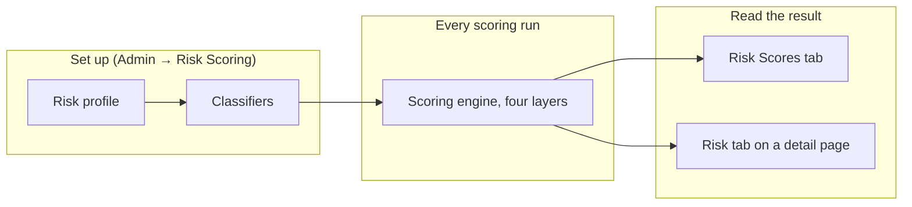

# How Scoring Works

!!! info "Before this page"
    Assumes you have read **[What a Risk Score Means](../concepts/risk-scoring-model.md)**.
    Brand new? Start at [The words you need first](../start/glossary.md).

Risk scoring has two parts. You set it up once in **Admin → Risk Scoring**: describe your organisation, let the AI provider turn that into classifiers, and activate them. After that the scoring engine runs inside Identity Atlas after every crawl and scores every account and resource against those classifiers.

## Setting it up

1. **Configure an AI provider.** Go to **Admin → LLM Settings** and add credentials for Anthropic, OpenAI or Azure OpenAI. The provider is used to write the risk profile and the classifiers, never to score.
2. **Switch the feature on.** In **Admin → Risk Scoring**, turn on **Risk Scoring Feature**. This also makes the **Risk Scores** tab available in the main navigation.
3. **Click New profile.** The Risk Profile Wizard walks through five steps:

    | Step | What you do |
    |---|---|
    | **Sources** | Enter your **Domain** (required), and optionally an organisation name, free-text hints and internal URLs to read, such as wiki or intranet pages. Click **Generate profile →**. |
    | **Generate & Refine** | Read the generated profile next to a chat. Ask for changes in plain words ("drop NIS2 — we're US-only") until it fits. Click **Looks good — save →**. |
    | **Save Profile** | Name the profile and leave **Make this the active profile** ticked. |
    | **Classifiers** | Click **Generate classifiers**, review the result, name the set, leave **Activate** ticked and click **Save classifiers →**. |
    | **Run Scoring** | Click **Run scoring now** and watch the progress bar, or click **Done** and let the next crawl trigger it. |

Nothing is stored until you save, so closing the wizard halfway discards the draft.

After the wizard, **Admin → Risk Scoring** shows the active **Risk Profile** and **Risk Classifiers**. See [Classifiers](./classifiers.md) for how to read them.

## When scoring runs

- **After every crawl.** When a crawl finishes, Identity Atlas links accounts to identities, refreshes generated contexts, and then runs risk scoring, in that order. Scoring is skipped when there is no active classifier set.
- **On demand.** Click **Run now** in **Admin → Risk Scoring**, or **Run scoring now** on the **Risk Scores** tab.

One run at a time: starting a second run by hand while one is in progress is refused. A run scores everything again and replaces the previous results.

## The four layers in detail

The final score is `0.50 × layer 1 + 0.20 × layer 2 + 0.10 × layer 3 + 0.20 × layer 4`, rounded and capped at 100.

### Layer 1 — Classifier match

Every classifier pattern is tested against the text fields of the account or resource. The **highest score among the matching classifiers** becomes the layer 1 sub-score. All matches are kept so you can see them later.

| Scored | Fields tested | Classifiers used |
|---|---|---|
| Resource | Display name, description, mail, external ID, and the values in its extended attributes | Groups |
| Account (human) | Display name, email, job title, department, company name, given name, surname, employee ID, external ID, and the values in its extended attributes | Users |
| Account (non-human) | The same fields as a human account | Agents; see [AI Agents & Non-Human Identities](./ai-agents.md) |

Two corrections apply:

- **Non-production discount.** A resource whose name marks it as a test, development or acceptance environment (for example `-DEV`, `_TST`, `-ACC`, `sandbox`, `staging`) keeps a quarter of its layer 1 sub-score, with a minimum of 5.
- **Noise guard.** A match is dropped when the matched text is about news bulletins, meeting rooms, calendars, shared mailboxes or distribution lists.

### Layer 2 — Membership analysis

Capped at 40.

| Scored | Signal | Points |
|---|---|---|
| Resource | 1 to 5 members | +5 |
| Resource | Has members but no owner | +5 |
| Account | Owner of more than 3 resources | +5 |
| Account | Member or owner of more than 15 resources | +3 for every three above 15, at most +15 |
| Account | Member of a resource with a layer 1 sub-score of 70 or higher | +15, once |
| Account | 5 or more direct reports | +3, rising to at most +15 |
| Account | 10 or more people in the reporting line below them | +5 (10+), +10 (25+), +12 (50+), +15 (100+) |
| Account | Manager of direct reports with a layer 1 sub-score of 70 or higher | +5 each, at most +15 |

The three manager signals apply only when the crawler collected who reports to whom.

Only Direct assignments count as membership. Ownership is counted separately and never as membership.

### Layer 3 — Structural hygiene

Capped at 25.

| Scored | Signal | Points |
|---|---|---|
| Resource | No description | +3 |
| Resource | Mail-enabled security group | +3 |
| Resource | Group that can be assigned directory roles | +15 |
| Resource | Dynamic membership rule switched on | +3 |
| Account | Disabled but still a member of something | +5 |
| Account | Guest account | +5 |
| Account | Last sign-in more than 90 days ago | +10 |

The sign-in signal applies only to accounts for which the crawler collected sign-in activity.

### Layer 4 — Risk propagation

First every account and resource gets a score from layers 1 to 3 alone. Then, in a single pass:

- an **account** inherits 30% of that score from the riskiest resource it is a Direct member of;
- a **resource** inherits 25% of that score from its riskiest member.

The pass runs once. Risk does not keep bouncing back and forth.

## Reading the result

- The **Risk Scores** tab shows the distribution over the tiers, the highest-scoring resources and accounts, and a list per type with a tier filter and a search box. The **Override** column shows where an analyst adjusted a score.
- The **Risk** tab on a detail page shows one score with its four layers, the classifiers that matched and the reason behind every point. See [What a Risk Score Means](../concepts/risk-scoring-model.md#a-score-always-explains-itself).

<!-- screenshot: Risk tab on an account detail page with Show Details open -->

## Data Privacy

!!! success "No identity data ever leaves your infrastructure"
    - **Only the wizard** contacts the AI provider — to write the risk profile, to refine it in the chat, and to generate classifiers from it.
    - **No identity data** — no user names, email addresses, group names, or access assignments — is ever sent to the AI provider.
    - All scoring (matching classifiers against your data) runs locally against your database with no network calls.

**What is sent to the AI, exactly:**

| What | Example |
|---|---|
| Domain name | `contoso.com` |
| Organisation name (optional) | `Contoso Ltd` |
| Free-text hints (optional) | `We operate in the Netherlands under NIS2` |
| Text from URLs you add (optional) | Text read from the wiki or intranet pages you listed |
| Your messages in the refinement chat | `Add a critical role for the payments team` |
| The risk profile itself | Sent back when you refine it and when classifiers are generated from it |

Nothing else. The AI generates regex patterns from this context; those patterns are then stored locally and applied against your data entirely on-premises.

**Provider security comparison:**

| Provider | Data stays in your region? | Used for AI training? |
|---|---|---|
| Anthropic API | No — routed to `api.anthropic.com` | Depends on your plan. Paid API plans include a no-training clause; verify your agreement. |
| OpenAI API | No — routed to `api.openai.com` | Consumer tier: opt-out required in account settings. Enterprise agreement: excluded by contract. |
| Azure OpenAI | Yes — stays within your Azure subscription | No — Microsoft Azure terms contractually exclude customer prompts from model training. |

For regulated environments or when in doubt, use **Azure OpenAI**: the data stays within your Azure tenant and training exclusion is contractual by default.
