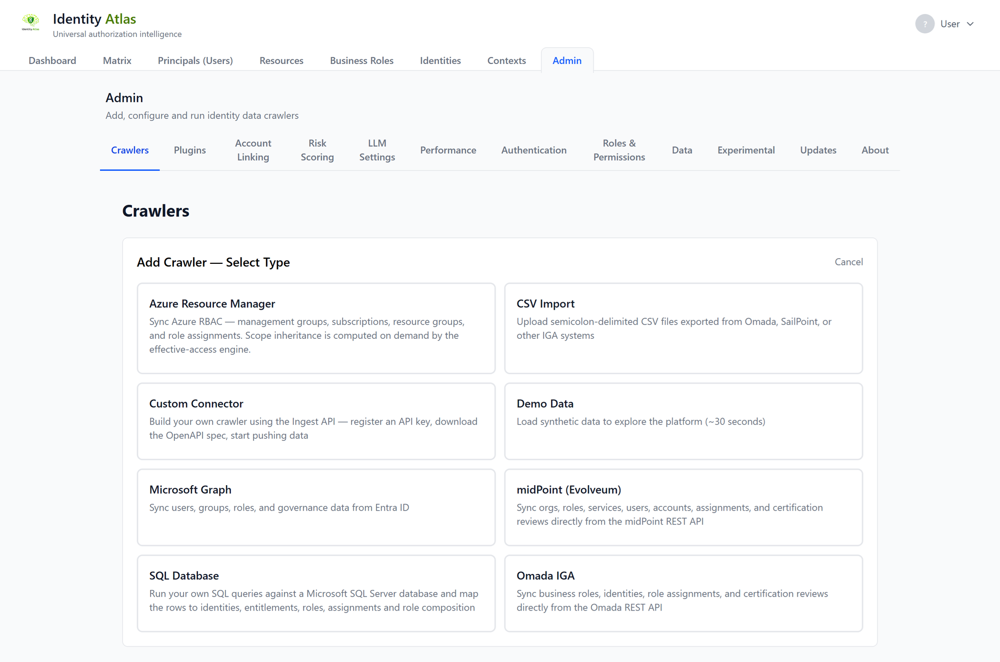

# Connect Entra ID

The Entra ID crawler reads your Microsoft Entra ID tenant through Microsoft Graph: accounts, groups and who is in them, directory roles, access packages, and how applications are set up. It only reads. Nothing is written back to the tenant.

**Use this when** your organisation uses Microsoft Entra ID (Azure AD). It is the usual first crawler: most other sources refer to accounts that live here.

---

## What you get

| In Entra ID | In Identity Atlas |
|---|---|
| Users | Accounts |
| Service principals, managed identities, AI agents | Accounts of type `ServicePrincipal`, `ManagedIdentity` or `AIAgent` |
| Groups | Resources of type `Group` |
| Group members | **Direct** assignments; members through a nested group are **Indirect** assignments |
| PIM-eligible group members | **Eligible** assignments |
| Group owners | A **Direct** assignment on a `GroupOwnership` resource named after the group |
| Directory roles | Resources of type `EntraDirectoryRole`, with **Direct** (active) and **Eligible** (PIM) assignments |
| Access packages | Business roles. The groups a package grants are linked to it, and its assignments are **governed** |
| Catalogs, assignment policies, requests, access reviews | Governance data shown with the business roles |
| Enterprise applications | `Application` resources, with their app roles (`AppRole`), consent grants (`DelegatedPermission`), app-only API permissions (`ApplicationPermission`) and owners |
| App registrations | `AppRegistration` resources with credential dates, redirect URIs and requested permissions |

You choose which of these to read in the wizard. The words used here are explained in the [glossary](../start/glossary.md).

After each run, Identity Atlas links accounts to identities and rebuilds contexts.

### Application security data

Several object types together show how risky an application is set up. None of them stores a secret: only key ids, names, types and validity dates.

- **Service Principals** adds to each service principal: `signInAudience`, `verifiedPublisherName` / `verifiedPublisherId`, `appRoleAssignmentRequired` (`false` means anyone in the tenant can sign in), `replyUrls`, and the credentials added to the service principal itself. A secret on the service principal is not shown under **App registrations** in the Azure portal, which makes it a known way to keep access hidden.
- **App Registrations & Credentials** creates one `AppRegistration` resource per app registration. Each holds `isFallbackPublicClient` (public-client flows allowed, which permits ROPC and device-code sign-in), `publicClientRedirectUris` / `webRedirectUris` / `spaRedirectUris`, `implicitGrantAccessTokens` / `implicitGrantIdTokens`, `requiredResourceAccess` with `requestedDelegatedPermissionCount` / `requestedApplicationPermissionCount`, and `federatedCredentials`.
- **Credentials** on either one are summarised as `secretCount`, `secretLatestEndDateTime`, `secretMaxValidityDays` and the same three for `certificate…`, with the full list in `credentials`. A secret that ends in 2299 shows up as a `secretMaxValidityDays` of about 100,000.
- **OAuth2 Delegated Grants**: a tenant-wide admin consent marks its `DelegatedPermission` resource `adminConsented: true` and adds no assignment, because no single user holds it. A per-user consent is a **Direct** assignment to that user.
- **Application Permissions** records when each permission was granted, as `grantedDateTime` on the assignment.

---

## Before you start

You need a way for the crawler to sign in, and Microsoft Graph permissions for what you want to read.

### Sign-in

Choose one:

- **App registration** — an app registration in your tenant with a client secret. This works in every installation. You need its tenant ID, client ID and client secret. Creating the app registration is standard Entra administration and is not covered here.
- **Managed identity** — only when Identity Atlas runs in Azure. There is no secret at all. See [Signing in without a secret](#signing-in-without-a-secret-managed-identity).

### Permissions

Grant these as **Application** permissions (not Delegated) on the app registration, then grant tenant-wide admin consent in the Azure portal under **App registrations → API permissions**. All of them are read-only. Grant only the ones for the object types you want; the wizard greys out an object type whose permission is missing.

| Permission | Object types it allows in the wizard |
|---|---|
| `User.Read.All` | Identity, Users & Groups & Members |
| `Group.Read.All` | Users & Groups & Members |
| `GroupMember.Read.All` | Users & Groups & Members |
| `Directory.Read.All` | Directory Roles, Service Principals |
| `RoleManagement.Read.Directory` | Directory Roles |
| `Application.Read.All` | Service Principals, Apps & AppRoles, App Owners, Application Permissions, App Registrations & Credentials |
| `EntitlementManagement.Read.All` | Identity Governance |
| `AccessReview.Read.All` | Identity Governance |
| `PrivilegedEligibilitySchedule.Read.AzureADGroup` | PIM |
| `RoleEligibilitySchedule.Read.Directory` | PIM |
| `DelegatedPermissionGrant.Read.All` | OAuth2 Delegated Grants |
| `AuditLog.Read.All` | Identity, Sign-in Logs (per-app activity) |

An object type becomes available as soon as one of its permissions is granted. The broader `ReadWrite` version of a permission also counts, but the crawler never needs it.

### Signing in without a secret (managed identity)

A client secret has to be stored, can leak, and expires. When Identity Atlas runs in Azure ([Azure deployment](../architecture/azure-deployment.md)) the crawler can sign in with a **managed identity** instead. There is then no secret anywhere: Azure hands a token only to code running inside the Identity Atlas containers, and nothing needs renewing.

The Azure deployment creates the identity for you (`<prefix>-mi-crawler`) and attaches it to the worker and the web app. It starts with **no permissions**. To use it:

1. **Grant it the Graph permissions.** A managed identity cannot be given Microsoft Graph permissions in the Azure portal, so use the script. Sign in with the Azure CLI as a Privileged Role Administrator or Global Administrator, then:

    ```powershell
    ./azure/Grant-CrawlerIdentityGraphPermissions.ps1 -ResourceGroup <resource group of the deployment>
    ```

    It grants the read-only permissions from the table above — nothing that can write — and skips the ones already granted, so it is safe to run again.

2. **Add the crawler.** Follow [Add the crawler](#add-the-crawler) and choose **Managed identity** as the sign-in method. There is nothing else to fill in on that step: the wizard validates the identity and shows which permissions it holds.

Things to know:

- **Same tenant only.** A managed identity reads the tenant the Azure deployment lives in. To read another tenant, use an app registration.
- **Grant before you validate.** Azure caches a managed identity's token. Permissions granted before the first validation or run work straight away; granted afterwards, they can take an hour or more to appear. The wizard reads the permissions from the token itself, so what it shows is what the crawler will really get.
- **Azure only.** The option appears only where the deployment has a crawler identity. A Docker installation outside Azure keeps using an app registration.
- **Who can use it.** Any Identity Atlas administrator who can add a crawler can add one that signs in as this identity — there is no secret to know. The identity's permissions are read-only.
- **Switching an existing crawler.** Click **Configure** on the crawler and choose **Managed identity**. The client secret stored for it is no longer used; delete the app registration's secret in Entra ID once the crawler runs.

---

## Add the crawler

1. Go to **Admin → Crawlers** and click **Add Crawler**.
2. Pick **Microsoft Graph**. That is the name of the Entra ID crawler in the list.
3. **Credentials.** Enter a **Crawler Name**, then the **Tenant ID**, **Client ID** and **Client Secret** — or choose **Managed identity**. Click **Validate & Next**. The wizard signs in and checks which permissions are granted.
4. **Object Types.** The wizard shows the granted permissions and ticks every object type they allow. Untick what you do not need — see [Which object types to select](#which-object-types-to-select).
5. **Identity.** Shown when **Identity** is ticked. Optionally filter which users count as identities, and pick extra attributes.
6. **Users & Groups.** Shown when **Users & Groups & Members** is ticked. Pick extra user and group attributes.
7. **Schedule.** A new crawler is proposed one full run a day at 02:00 UTC and a delta every 15 minutes. Change or remove them as you like.
8. Click **Deploy to Worker**. The crawler appears as a card. Click **Run Full** on the card to load the data now, or wait for the schedule.

<figure markdown="span">
  
  <figcaption>Admin → Crawlers → <strong>Add Crawler</strong>. Pick <strong>Microsoft Graph</strong> for Entra ID.</figcaption>
</figure>

---

## Settings

### Credentials

| Wizard label | Meaning | Default |
|---|---|---|
| **Crawler Name** | The name on the crawler's card. Required. | Empty |
| **Sign-in method** | **App registration** or **Managed identity**. Only shown in an Azure deployment that has a crawler identity. | App registration |
| **Tenant ID** | The directory (tenant) ID. Not asked for a managed identity. | Empty |
| **Client ID** | The application (client) ID of the app registration. | Empty |
| **Client Secret** | The app registration's secret. When you edit a crawler, leave it blank to keep the stored one. | Empty |

### Which object types to select

On a new crawler the wizard ticks every object type the granted permissions allow. Some are expensive on a large tenant, so choose by what you want to see:

| You want to see… | Tick | Cost on a large tenant |
|---|---|---|
| The personal user accounts that stand for people, as identities | **Identity** | |
| Users, groups and who is in which group | **Users & Groups & Members** | |
| Non-human accounts: service principals, managed identities, AI agents | **Service Principals** | |
| Access packages, their assignments, policies and reviews | **Identity Governance** | |
| Privileged access through Entra directory roles, active and PIM-eligible | **Directory Roles** | |
| PIM-eligible group memberships | **PIM** | High — one request per group |
| Who can use which enterprise application (app-role assignments) | **Apps & AppRoles** | |
| Consent grants to applications, per user and tenant-wide | **OAuth2 Delegated Grants** | |
| App-only API permissions held by service principals, managed identities and agents | **Application Permissions** | High — read per service principal |
| How each app registration is set up: secrets and certificates, public-client flows, redirect URIs, federated credentials | **App Registrations & Credentials** | Low — one paged read |
| Who owns applications and service principals, and so can add a credential and act as the application | **App Owners** | High — read per application |
| Owners of AI agents and sponsors of guest accounts | **Agent Owners & Guest Sponsors** | |
| When each user last used each application | **Sign-in Logs (per-app activity)** | |
| A face next to each user's name | **Profile Photos** | High on the first run — one request per user |

**Application Permissions** and **Agent Owners & Guest Sponsors** work on service principals, so tick **Service Principals** with them. That is also where AI agents are recognised.

**A note on profile photos.** Photos are personal data, and nothing else the crawler stores is of that kind. Check what your organisation's privacy agreements require before turning them on. The first run makes one request per account. After that, answers are remembered — including "this account has no photo" — and only re-checked after 30 days. **Profile Photos** is listed when you open a saved crawler with **Configure** and leave the client secret blank.

### Identity

| Wizard label | Meaning | Default |
|---|---|---|
| **Identity Filter** | Limits which users become identities. Users that do not match are left out of the identities. | Off |
| **Attribute** | The user attribute to test. | `employeeId` |
| **Condition** | **Is not empty**, **Equals**, **Not equals** or **In values (comma-separated)**. | Is not empty |
| **Value** | The value to compare with. Not asked for *Is not empty*. | Empty |
| **Identity Attributes to Sync** | Extra user attributes to keep on identities. Attributes marked *core* are always read. | A preset of common attributes, where the tenant has them |

### Users & Groups

| Wizard label | Meaning | Default |
|---|---|---|
| **User attributes** | Extra user attributes to keep on accounts. Attributes marked *core* are always read. | A preset of common attributes |
| **Group attributes** | Extra group attributes to keep on groups. | A preset of common attributes |

Extra attributes are shown on the detail page of the account or group.

### Schedule → Advanced options

| Wizard label | Meaning | Default |
|---|---|---|
| **Sign-in logs window (days)** | How many days of sign-in events each run reads, from 1 to 30. | 7 |
| **Extra AI-agent name patterns (one regex per line)** | Extra name patterns that mark a service principal as an AI agent, on top of the built-in list. Not case-sensitive. | Empty |

---

## Schedule and refresh

How schedules and the run buttons work is the same for every crawler: see [Schedule and run crawlers](scheduling.md). What is specific to Entra ID is how much a delta run reads.

- A **delta run** reads only what changed since the previous run, for the data Microsoft Graph can report that way:
    - **users** and **service principals**: new, changed and deleted accounts;
    - **groups**: new, changed and deleted groups;
    - **direct group memberships and group owners**: members and owners added or removed.

    A delta takes minutes, even on a large tenant, so you can run it every 5 to 30 minutes.
- A **full run** reads everything you selected. That includes what a delta leaves out: nested (indirect) group memberships, PIM eligibility, governance, app roles, OAuth2 grants, application permissions, app registrations, directory roles, sign-in activity and profile photos. On a large tenant this takes hours.

The data only a full run reads is as fresh as your last full run. Keep at least one full run a day.

Two things to know about delta runs:

- **No baseline yet.** If a delta run hits a crawler that has never completed a run, it runs as a full run instead. That way a new crawler never shows users without their groups.
- **Service principal details.** A delta run refreshes a service principal's credentials, but Microsoft Graph's change feed leaves out `verifiedPublisher`, `signInAudience` and `appRoleAssignmentRequired`. A service principal that changes between full runs shows those three again after the next full run.

---

## What a refresh removes

A full run removes from Identity Atlas what the tenant no longer has, within this crawler's own system. A delta run removes the users, service principals, groups, memberships and owners that Microsoft Graph reports as deleted. See [What a full run removes](scheduling.md#what-a-full-run-removes).

---

## Limitations

- **Read-only.** The crawler never changes anything in Entra ID.
- **One tenant per crawler.** Add a second crawler for a second tenant.
- **A managed identity reads its own tenant only.**
- **Delta runs cover users, service principals, groups and direct memberships.** Everything else is refreshed by full runs.
- **Sign-in events** go back at most 30 days.

---

## Troubleshooting

| Symptom | Cause / fix |
|---|---|
| **Validate & Next** shows a red error | The sign-in to Microsoft failed; the message is Microsoft's own. Check the tenant ID, client ID and client secret, and that the secret has not expired. |
| An object type is greyed out with *(missing permissions)* | None of the permissions for that type is granted. Grant one from [the table](#permissions), give admin consent, and validate again. |
| The **Sign-in method** choice is not shown | This installation has no managed identity for crawlers. Use an app registration, or run Identity Atlas in Azure with the crawler identity. |
| A managed identity shows a permission as missing right after you granted it | Azure caches the identity's token. Wait an hour or more and validate again. |
| The Object Types step says *Permissions weren't re-checked* | You opened a saved crawler without entering the client secret, so the wizard could not sign in. Enter the secret on the first step to see the permissions. |
| PIM, access packages, app roles or nested memberships look out of date | Delta runs do not read them. Click **Run Full**, and check that a full run is scheduled. |
| A delta run took as long as a full run | The crawler had no baseline yet, so the run was done as a full run. The next delta is short. |

---

## Deep dive

- [Schedule and run crawlers](scheduling.md)
- [Azure deployment](../architecture/azure-deployment.md) — where the managed identity comes from
- [Crawler architecture](../architecture/crawler-architecture.md)
- [Ingest API](../architecture/ingest-api.md)
