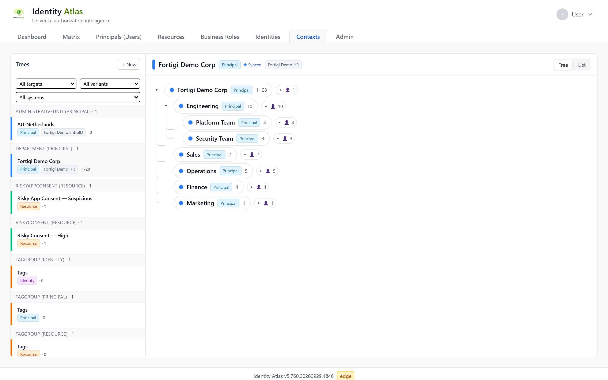

# Contexts

!!! info "Before this page"
    Assumes you have read **[The words you need first](../start/glossary.md)** — the eight minutes that make the rest of this readable.

The **Contexts** tab is where you group the people, accounts, resources and systems in your data into named trees, and then use those groupings to scope the matrix. Departments, manager hierarchies, applications and tags are all contexts.

The tab is hidden by default. To show it, open the account menu in the top-right corner and switch on **Contexts** under **Visible Tabs**.

<figure markdown="span">
  
  <figcaption>The Contexts tab: every tree on the left, the selected tree — here a synced department hierarchy — on the right.</figcaption>
</figure>

!!! info "Where the architecture lives"
    This page is the task-oriented guide. For the data model and plugin framework, see [Context Redesign](../architecture/context-redesign.md) and [Context Redesign — UI](../architecture/context-redesign-ui.md).

---

## What a context is

A **context** is a named group of things. Contexts nest into **trees** (a root with units under it), and every context is one of three **variants**, depending on where it came from:

| Variant | The tab calls it | Comes from | Can you change it? |
|---------|------------------|-----------|--------------------|
| **Synced** | Imported | A crawler reads the tree from a source system, such as a department hierarchy from HR | No. The next crawl overwrites it. You can add your own units under it. |
| **Generated** | Derived | A rule (a *plugin*) that builds a tree from data already loaded, such as a manager hierarchy | Partly. You can rename and move units, and your changes survive a refresh (see [Refresh a derived tree](#refresh-a-derived-tree)). |
| **Manual** | Created here | You build it by hand | Yes, all of it. |

Every tree also holds exactly one kind of member, its **target type**. The target type decides which side of the matrix a context can scope:

| Target type | The tab calls its members | Example |
|-------------|---------------------------|---------|
| **Identity** | People | A department from HR, a project team |
| **Principal** | Accounts | The accounts that report to one manager, orphaned accounts |
| **Resource** | Resources | All groups of one application, the resources of one Azure subscription |
| **System** | Systems | All systems of one business unit |

A tree keeps one target type all the way down, but it can mix variants: a unit you made by hand can sit under an imported department.

Besides its variant and target type, a context has a **context type**: a short label for what kind of grouping it is, such as `Department`, `Application` or `Tag`. Imported and derived trees bring their own; for a tree you make by hand you type it yourself.

---

## The two-pane layout

The Contexts tab has one tab per template — **Organisation**, **Applications**, **Tags** and **Segments** — and each is split in two:

- **Left — the trees.** The tab's trees as one tree, under a heading per source (Imported · *system*, Derived · *rule*, Manager hierarchy, Created here). On Organisation, **Show:** switches between the People, Accounts and Resources trees, because each tree holds one kind of member. Each row shows one member count (everyone including sub-units; the direct share is in its tooltip). Filters at the top narrow by source, system and — on Tags and Segments — kind.
- **Right — the selected context.** Selecting a unit, application, tag or segment shows its page in place: its key facts, who is accountable and responsible, its sub-units and the people overview. **Open as page** in the header's **⋯** menu opens it on its own.

Expand a row with its arrow to see its sub-units. A unit's members are listed on its page.

### The Timeline

The folded **Timeline** at the bottom of a unit's page says what happened, in words, with who or what did it:

| Filter | What it shows |
|---|---|
| **People** | Who joined and who left ("Lisa Vos joined (list upload: Teams.xlsx)"), and changes to its people's job title, department, manager or account (disabled, deleted in the source) — also of someone who left during the period |
| **Roles** | Accountable and Responsible set, changed ("Accountable changed: Sophie Willems → Tom Bakker (analyst)") and removed, and whether that came from the source owner, a rule, an analyst or an interview |
| **Structure** | Renamed, moved under another unit, description and other details, tree adjustments and change requests |
| **Knowledge** | What the sources did: uploads, claims extracted and decided (with organisation knowledge on) |

Many like changes on one day — a list upload adding 40 people — fold into one line ("40 people joined (list upload)") that opens to the names. Joins and leaves are known from the day your installation began recording them; members who joined earlier show when they were added, except members a rule derives.

### Sources added on another unit

An interview added on the parent unit often says who in a sub-unit does what. Such a source is also listed under the sub-unit's **Sources**, marked *added on <that unit>*, with the number of its claims about the sub-unit's people. You can view it there; reading it again, adding claims or deleting it is done on the unit it was added to.

---
## Create a context

You need the **Build contexts** permission (`data.write.contexts`); without it the tab is read-only.

Click **+ New** at the top of the tree pane. The **New context tree** dialog first asks where the tree should come from:

| Card | What it does |
|------|--------------|
| **Import from a system** | Nothing is built here: imported trees appear after a crawler reads them. **Open Crawlers →** takes you to **Admin → Crawlers** to set one up. |
| **Derive from data** | Builds a tree from data that is already loaded, with one of the built-in rules. |
| **Create by hand** | Starts an empty tree you fill yourself. |
| **Upload a list** | Reads your own list of units or applications from a `.csv` or `.xlsx` file, with owners, members and attributes. Upload the file again later to update the tree. |
| **Describe it** | Opens the context builder, where you describe a process, application or project and pick the groups from suggested search terms. See [Building a context by describing it](context-assistant.md). |

!!! note "Describe it is experimental"
    The **Describe it** card is only there when an operator has switched on the context assistant under **Admin → Experimental** and you hold the **Build contexts** permission.

### Derive from data

1. **Pick a rule.** The rules are listed per kind of member they group.
2. **Configure.** Fill in what the rule asks for, for example which system to read or which account attribute to use.
3. **Preview & run.** The preview shows how many contexts and members the rule would create, with samples, before anything is written. Choose **Create a new tree** or **Refresh an existing tree**, then press **Create tree** (or **Refresh tree**).

The rule runs in the background. You land on the run's progress page, and the finished tree appears in the tree pane.

Running a rule needs the `admin.context-plugins` permission as well.

The built-in rules:

| Rule | Groups | Builds a tree from |
|------|--------|--------------------|
| Manager Hierarchy | Accounts | Who reports to whom |
| Department from Principal | Accounts | The department on each account |
| Active Directory OU Tree | Accounts | The OU path in the account's distinguished name |
| Principal Type Tree | Accounts | The kind of account (user, service principal, …) |
| Orphaned Accounts | Accounts | Live accounts that are not linked to any identity, per kind of account |
| Principals by System | Accounts | The system each account was loaded from |
| Resource Cluster | Resources | Words that resource names have in common |
| Resource Type Tree | Resources | The resource type (and, for Azure, the resource plane) |
| Scope Hierarchy | Resources | The Azure nesting of management groups, subscriptions and resource groups |
| Entra Group Category Tree | Resources | The Entra group category |
| Risky Consent | Resources | The risk tier of OAuth consents, and app consents that were flagged |
| Resources by System | Resources | The system each resource was loaded from |
| Context assistant recipe | Resources | Search terms saved in the context builder, plus resources added by hand |

### Create by hand

Fill in the **Details** step and press **Create**:

- **Target type**: what the tree will hold.
- **Template**: whether this is an organisation, an application, a tag or a segment. It decides which of the tab's sub-tabs the tree shows under.
- **Context type**: the free-form label described above, for example `Application` or `Team`.
- **Display name** and, optionally, a **Description**.
- **Scope system** (optional): ties the tree to one source system. Leave it empty for a tree that spans systems.

You land on the empty root, ready to add units and members.

---

## Refresh a derived tree

A derived tree does not follow the data by itself. To bring it up to date, open the **⋯** menu on the tree's root row in the tree pane and choose **Refresh**. The rule runs again on that tree, so a person who changed manager moves under the new manager.

**Your changes are kept**: units you renamed or moved, units you added by hand and members you moved by hand survive the refresh. The one exception: when the rule no longer produces a unit, that unit is removed together with everything still under it, including units you added there.

---

## Change a tree

On a tree made by hand, and on the hand-made and derived parts of any tree, you can reshape the hierarchy in the tree pane:

- **Rename**: double-click a unit's name and type a new one.
- **Add a sub-unit**: use the **Add a sub-unit** button on a unit. The new unit takes over the parent's target type.
- **Move**: drag a unit onto another unit to put it under that one. A move that would create a loop is refused, and the member counts on both branches are recalculated.
- **Delete a tree**: open the **⋯** menu on the tree's root row and choose **Delete this tree…**. This removes the root and every unit under it; the members themselves are not deleted. Imported trees cannot be deleted here, because the next crawl would bring them back.

On a **Manager Hierarchy** tree there is one more move: drag a person onto another team to record that they report to that team's manager. The person moves at once, and the change sticks after the next refresh.

Imported units are otherwise read-only: you can add your own units under them, but you cannot rename or move the imported units themselves.

---

## Scope the matrix with a context

A context becomes a condition in the matrix wizard. There is no separate context control on the matrix itself.

1. On the **Matrix** tab, choose **New matrix**, or **Adjust** on a matrix that is already open.
2. On the **Subjects** step or the **Resources** step, find the **Include** list (or **Exclude**, to leave a context out) and click **+ Context**.
3. Pick any tree or unit from the picker. Each step only offers the contexts that fit it:
    - **Subjects** offers contexts of accounts when the matrix is on **User accounts**, and contexts of people when it is on **Identities**.
    - **Resources** offers contexts of resources and contexts of systems.
4. The condition appears in the list. Leave **incl. descendants** ticked to include the units under the one you picked; untick it to take only its own members. Remove a condition with its **×**.
5. Go on to the last step, **Save & share**, and press **Show matrix** (or give the matrix a name first to save it).

By default the resources are the rows of the matrix and the people or accounts are the columns, so by default a context of people or accounts decides which columns you see, and a context of resources or systems decides which rows. The headings on the two steps (**Columns are** and **Rows are**) say which is which for the matrix you are building.

Several conditions in one **Include** list all have to hold. That is how you get "people in Finance **and** on the Amsterdam site". A condition on **Subjects** and one on **Resources** together give "the people in Finance against the resources of the Procurement application".

!!! tip "Straight from a context"
    On the page of an organisation unit or an application, the **⋯** menu in the header has **View in matrix ↗**. It opens a matrix scoped to that context in a new browser tab.

The scope is part of the matrix's address, so a scoped matrix can be bookmarked. To hand one to a colleague, see [Sharing a matrix](sharing-a-matrix.md).
