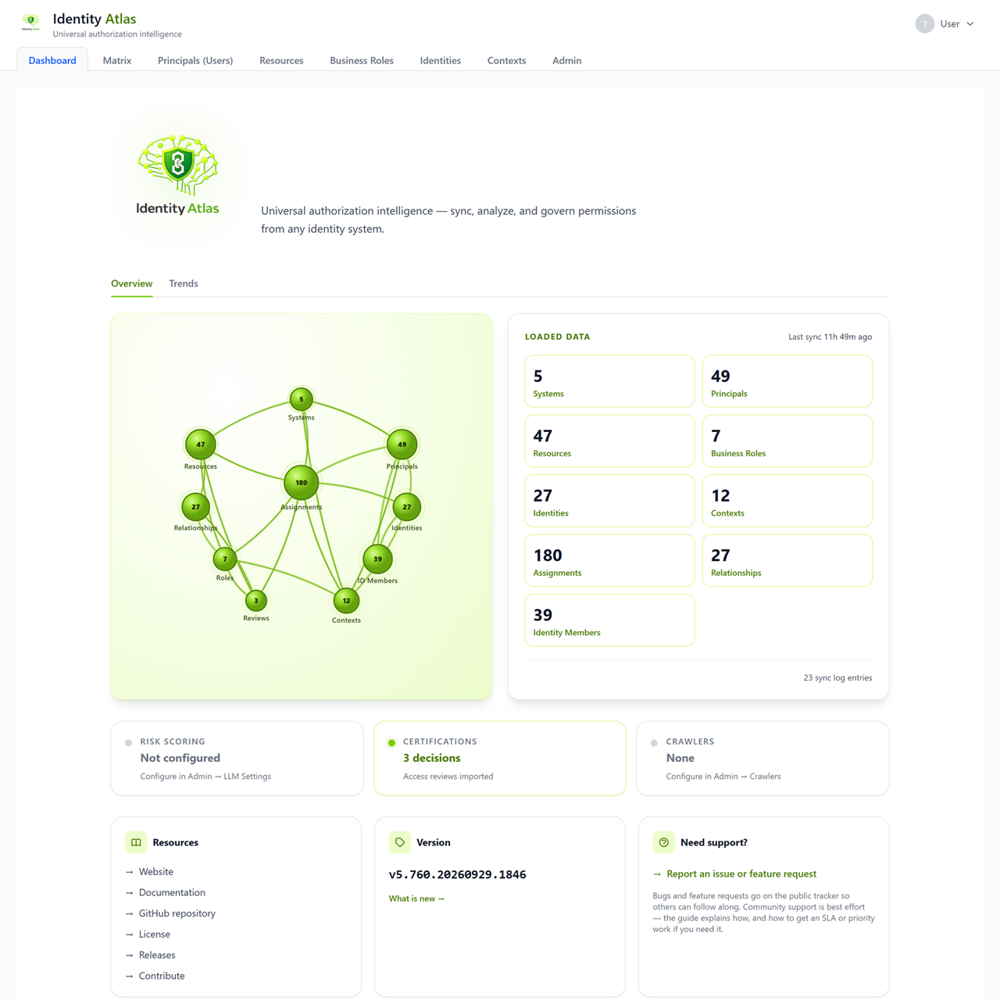

# Dashboard

!!! info "Before this page"
    Assumes you have read **[The app at a glance](./overview.md)**.
    Brand new? Start at [The words you need first](../start/glossary.md).

The **Dashboard** is the landing page — the first thing you see when you open
Identity Atlas. It's a one-shot overview of what's loaded, whether the key
features are configured, and where to go next. It has two tabs: **Overview**
and **Trends** (how the numbers moved over time). Both are described below.

<figure markdown="span">
  
  <figcaption>The Dashboard's Overview tab, shown on the synthetic demo dataset.</figcaption>
</figure>

---

## Reading the Overview

### The brain graph

The left panel is a brain-shaped network graph that echoes the Identity Atlas
logo. Each node is an entity type — Systems, Principals, Resources, Roles,
Identities, Contexts, Assignments, Relationships, ID Members, and Reviews — and
its number is the current count. Nodes that hold data glow and pulse in lime
green with the connections between them animated; empty types stay dim. Node size
scales (on a log scale) with the count, so a system with millions of assignments
doesn't dwarf one with dozens. It's decorative, but it gives an at-a-glance sense
of how full and how connected your data is.

### Loaded data (entity counts)

The right panel lists the live counts for every entity type:

| Card | Opens |
|---|---|
| Systems | Systems list |
| Principals | Principals/Users list |
| Resources | Resources list |
| Business Roles | Business roles / access packages |
| Identities | Identities list |
| Contexts | Contexts |
| Assignments | — (count only) |
| Relationships | — (count only) |
| Identity Members | Identities list |

Cards with data are clickable and jump straight to that list; empty ones are
greyed out. Above the grid, **Last sync** shows how long ago the most recent
crawler run finished. A link at the bottom shows the number of **sync log
entries** and opens the sync log.

### Feature status row

Once data is loaded, three status cards summarise the optional features, each with
a coloured dot (green = active, amber = needs attention, grey = not configured):

- **Risk Scoring** — whether an LLM is configured and how many entities have been
  scored. Clicking it opens Admin → Risk Scoring.
- **Certifications** — how many access-review decisions have been imported.
- **Crawlers** — how many crawlers are configured and whether any job is running
  right now. Clicking it opens Admin → Crawlers.

### Links, version, and support

The bottom row has three cards: **Resources** (website, documentation, GitHub,
license, releases), **Version** (the running version, with a "What is new" link to
the changelog), and **Need support?** (a link to [report a bug or request a
feature](../contributing/report-an-issue.md)). A banner appears above
everything if your `docker-compose.prod.yml` is outdated, with the command to
re-download it.

---

## Reading the Trends tab

**Trends** shows how your data changed, one point per day. Identity Atlas records the day's counts
once a day, early in the day (UTC), while it is running. The lines start on the day your installation
began recording and grow from there: nothing is filled in for the time before, so a new installation
shows a single point at first.

Pick the period with **Range**: 30 days, 90 days (the default), 1 year or 2 years.

| Chart | What it shows | What to look for |
|---|---|---|
| **Governed assignments — % of total** | The share of all assignments that a business role grants, with today's figure next to it | The headline number for governance: a rising line means more access is handed out on purpose, through business roles |
| **Users (principals)** | The number of accounts | Jumps after a crawler is added or a source is cleaned up |
| **Resources** | The number of resources | The same, for groups, roles and other resources |
| **Assignments** | The number of assignments | Access growing faster than the number of accounts |
| **Governed assignments (raw count)** | The number of governed assignments | Read it with the percentage: the share can drop while this count rises, when access outside business roles grows faster |

The counts of accounts, resources and assignments are close estimates, good to within a few percent;
the governed figures are exact. For how the snapshots are taken, see
[Dashboard Trends](../architecture/dashboard-trends.md) under the hood.

---

## When there's no data yet

On a fresh install the Loaded-data panel shows an empty state with a **Configure a
crawler →** button that takes you to Admin → Crawlers. From there you can connect
Entra ID, upload CSV exports, or click **Load Demo Data** to explore with synthetic
data. See the [Quick Start](../quickstart.md) for the end-to-end first-run flow.

!!! note "Load error vs. empty database"
    An empty database and a failed load look different on purpose. If the dashboard
    can't reach the server it shows a red "Couldn't load the dashboard" card with a
    **Retry** button — and deliberately does *not* show the onboarding CTA, so a
    transient error is never mistaken for lost data.
