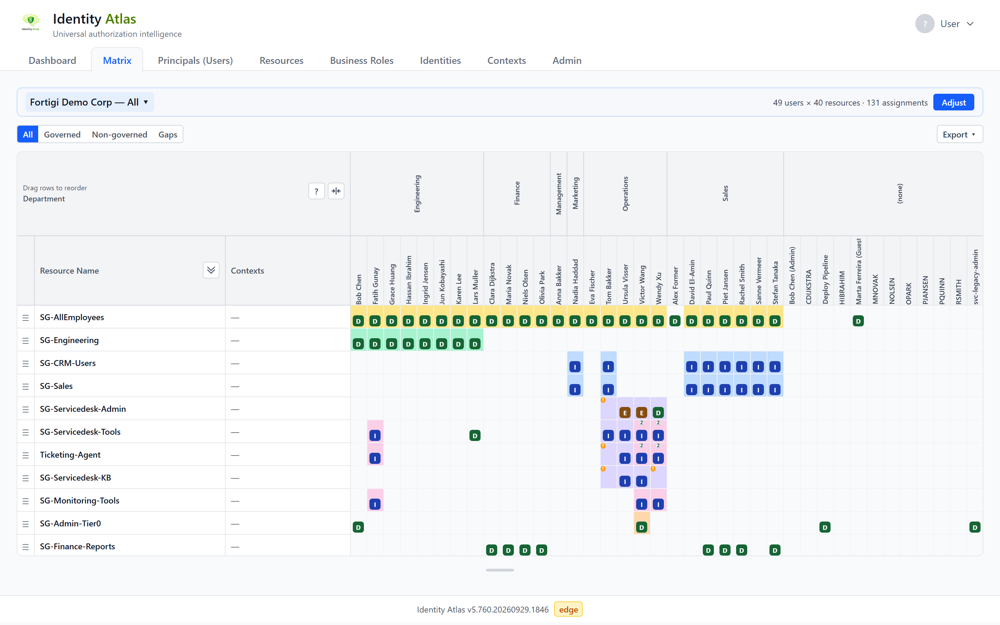
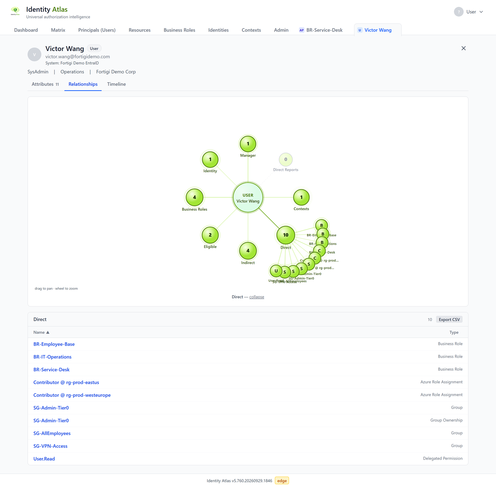
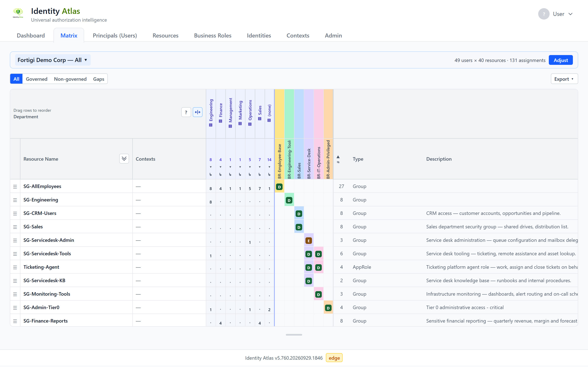
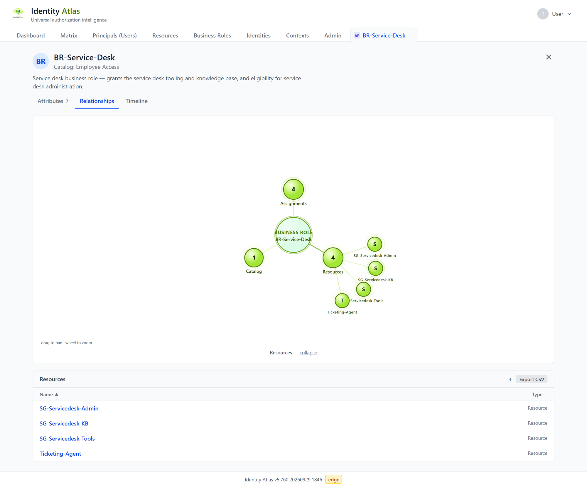
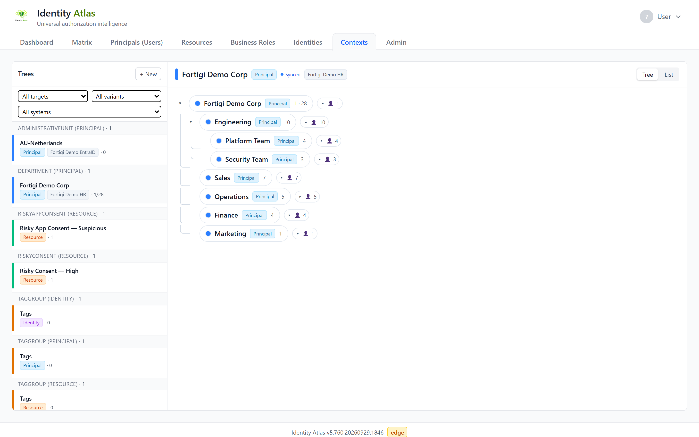
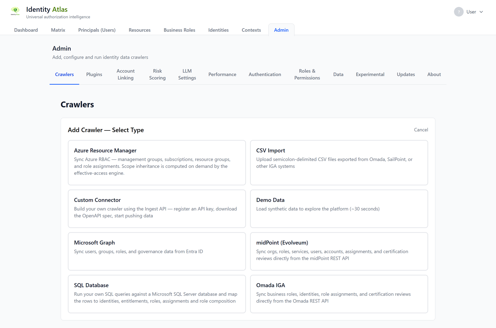

# The app at a glance

!!! info "Before this page"
    Assumes you have read **[The words you need first](../start/glossary.md)** — the eight minutes that make the rest of this readable.

Identity Atlas is a web application: you open it in a browser and everything you do with the loaded
data happens there. This page is the map. It says what each tab is for and points to the page that
explains it in detail.

<figure markdown="span">
  
  <figcaption>The Matrix — the core view. Every screenshot in this documentation shows the synthetic demo dataset, which you can explore in the <a href="https://demo1.identityatlas.io">live demo</a>.</figcaption>
</figure>

---

## The tabs

The app opens on the **Dashboard**. The navigation bar holds these tabs:

| Tab | What it is for | Shown |
|-----|----------------|-------|
| **Dashboard** | What is loaded, whether the key features are set up, and trends over time | Always |
| **Matrix** | Who holds what, as a grid you scope yourself | Always |
| **Principals (Users)** | Every account, of people and of software | Always |
| **Resources** | Everything that grants access | Always |
| **Systems** | The systems the data comes from | When you switch it on |
| **Business Roles** | Business roles and access packages from your governance platform | Always |
| **Risk Scores** | Accounts, resources and roles ranked by risk | When an administrator has switched risk scoring on |
| **Identities** | People, with the accounts that belong to each | When you switch it on (offered while account linking is on) |
| **Contexts** | Groupings such as departments, applications and tags | When you switch it on |
| **Reports** | Ready-made and self-built reports | Always |
| **Logs** | What ran and when: crawler syncs, plugin runs, account linking, risk scoring | When you switch it on |
| **Admin** | Crawlers, sign-in, permissions and other settings | When you hold an administrative permission |

### Showing the optional tabs

Systems, Identities, Contexts and Logs are hidden until you ask for them. Click your name in the
top-right corner and use the switches under **Visible Tabs**. The choice is yours alone and is
remembered for your account. The same menu holds the **Light / Auto / Dark** theme choice and
**Sign out**.

### Detail tabs

Clicking a name anywhere in the app (an account, a resource, a business role, an identity, a context)
opens that record in a tab of its own, next to the tabs above. Several can be open at once; each has a
close button, and its address can be bookmarked.

An account, resource, business role or identity page has the same set of views:

- **Attributes**: everything the source says about the record.
- **Relationships**: a graph of what the record is connected to. Click a node to list what is in it.
- **Timeline**: what changed, and when.
- **Diff**: the record now, next to how it was at a moment you pick.
- **Risk**: the risk score and what produced it (only while risk scoring is on and the record has a score).

<figure markdown="span">
  
  <figcaption>An account's detail tab — the Relationships view, with the direct assignments fanned out.</figcaption>
</figure>

---

## Dashboard

The landing page. **Overview** shows the counts of everything that is loaded and the state of risk
scoring, certifications and crawlers. **Trends** shows how those numbers moved over time.
See [Dashboard](dashboard.md).

## Matrix

The grid of who holds what. By default the resources are the rows and the people or accounts are the
columns; a cell shows *how* the access is held: `D` for Direct, `I` for Indirect, `E` for Eligible.

The matrix never shows everything at once. With no matrix open, the tab lists the saved matrices
under **Open a matrix** and offers **New matrix**. A new matrix is built in a wizard with four steps:

1. **Subjects**: one column per **user account**, or one per **identity** (a person across all their accounts), and which of them.
2. **Resources**: which resources, and whether each business role also gets a row of its own with the resources it grants under it.
3. **Layout**: how the columns are grouped and sorted, whether they are rolled up into counts per department or other attribute, and what the matrix opens with.
4. **Save & share**: show the matrix as it is, or give it a name to save it and share it.

The strip above an open matrix names it and has **Adjust**, which reopens the wizard on that matrix.

Two controls are easy to confuse because both are about business roles:

- **Whether business roles are in the grid** is part of what the matrix *contains*. You choose it on the wizard's **Resources** step.
- **The lens** (**All / Governed / Non-governed / Gaps**, above the grid) decides which of the assignments in that grid are highlighted. It changes the view, not the content, and anyone looking at the matrix can switch it.

A cell with a coloured background is governed: a business role grants that access. The **?** button
in the top-left corner of the grid explains every badge, colour and marker of the matrix you are
looking at. **Export** above the grid downloads the matrix as an Excel file.

<figure markdown="span">
  
  <figcaption>The same matrix with every department folded into a count column, next to the business-role columns.</figcaption>
</figure>

More on the matrix:

- [Sharing a matrix](sharing-a-matrix.md): handing a matrix to someone who does not use Identity Atlas.
- [Contexts](contexts.md#scope-the-matrix-with-a-context): scoping a matrix to a department or an application.
- [Who can access resource X, and why](effective-access.md): reading inherited access.
- [Matrix scope statistics](../architecture/matrix-scope-statistics.md): the optional panel with totals and trends above the grid.

## Principals (Users)

Every account that was loaded. The sub-tabs split them by kind: **Users**, **Service Principals**,
**Managed Identities** and **AI Agents**, or **All** together.

- **Search** by name, and narrow the list with **+ Add filter**.
- **Tag** the rows you select, or every row that matches the current filters. Click a tag to filter on it.
- **Compare** two or three accounts side by side: tick them in the list and click **Compare**, or use
  **Compare with…** on an account's page. By default only the attributes and access where they differ
  are shown.

Click a name to open the account's [detail tab](#detail-tabs).

### Filtering on relationships

The **+ Add filter** list holds a row's relationships next to its ordinary attributes, and they work
the same way: pick the field, pick a value.

- The relationships include *Owners* and *Sponsors* (on AI agents, service principals and guests),
  *Manager* and *Direct reports* (on users), *Owns agents*, and *Members* and *Owners* (on groups and
  other resources).
- The values are counts: **None (0)**, **Any (1 or more)**, **Exactly 1**, **2 or more**,
  **3 or more**. A relationship that can only have one value, such as a manager, offers *None* and *Any*.
  Filter AI Agents on *Owners = None (0)* to find every agent nobody answers for, or groups on
  *Members = None (0)* to find empty groups.
- Only relationships that have data in the list you are looking at are offered.
- Member counts include direct, indirect and eligible members. Accounts that were removed from the
  source are not counted.

The same filters are on the Resources tab.

## Resources

Everything that grants access: groups, directory roles, app roles, applications, permissions and more.
Search, filter on type or system, and tag rows as on the Principals tab.

A resource's page names its **Owner** in the header, linked to that person's account when Identity
Atlas holds one, and has an **Owners** node on its Relationships view. The reverse is on the person's
page: an **Owned Resources** node lists what they answer for.
[Who can access resource X, and why](effective-access.md) walks through a resource page.

## Systems *(optional tab)*

One card per connected system, with what was loaded from it: the number of resources and assignments,
the resource types and assignment types it contains, and its owners.

## Business Roles

The business roles from your governance platform: access packages from Entra ID, business roles from
Omada, and their equivalents elsewhere. Search the list, and give each role a **category** to group
the roles; a role has one category at a time.

<figure markdown="span">
  
  <figcaption>A business role's detail tab — the Relationships view, showing the resources the role grants.</figcaption>
</figure>

A business role's page shows who holds the role, which resources it grants, and what the governance
platform recorded about it: its assignment policies, access reviews and pending requests.

!!! important
    Access reviews are **read-only** in Identity Atlas. Decisions are made in the governance platform
    and shown here.

## Risk Scores *(when risk scoring is on)*

Accounts, resources, business roles and identities ranked by a risk score from 0 to 100, with a tier
from *None* to *Critical*. Open a record's **Risk** view to see what produced its score and, as an
analyst, to adjust it with a written reason.

An administrator switches the feature on and sets it up under **Admin → Risk Scoring**. Scoring needs
an active set of classifiers; once there is one, the scores are recalculated after every crawl, and
can also be run by hand from **Admin → Risk Scoring**. Until scores have been computed the tab says so
and offers to run the scoring.
See [Risk scoring](../risk-scoring/overview.md) for how a score is built.

## Identities *(optional tab)*

The people behind the accounts. Each identity lists the accounts that belong to the same person across
systems. Accounts are linked to people by the crawler or by account linking, which an administrator
configures under **Admin → Account Linking**. See [Account linking](../architecture/account-linking.md).

## Contexts *(optional tab)*

Named groupings of people, accounts, resources or systems: departments, manager hierarchies,
applications, tags. You browse and build them here, and use them to scope the matrix and reports.

<figure markdown="span">
  
  <figcaption>The Contexts tab, with a synced department tree selected.</figcaption>
</figure>

See [Contexts](contexts.md).

## Reports

**Standard reports** come with Identity Atlas. **Saved views** are standard reports with their settings
stored under a name. **Custom reports** are built by people in your organisation; that part is
experimental and off until an administrator switches it on. Every report opens in its own tab, runs on
the latest data, and can be downloaded.

- [Entitlement Pivot and saved views](entitlement-pivot.md)
- [Unit Report](unit-report.md)
- [Access Review Adoption](access-review-adoption.md)
- [Custom Reports](custom-reports.md)

## Logs *(optional tab)*

What ran, when, and how it ended: crawler syncs, plugin runs, account linking and risk scoring. Filter
on the kind of run, or search by name or by who started it.

## Admin

The Admin tab groups the administrative pages. You only see the ones your permissions allow.

| Page | What you do there |
|------|-------------------|
| **Crawlers** | Add, configure, schedule and run the crawlers that load data |
| **Plugins** | Manage the rules that derive contexts, and their runs |
| **Account Linking** | Set the rules that link accounts to people |
| **Risk Scoring** | Switch risk scoring on and set up the risk profile and classifiers |
| **LLM Settings** | Choose the language model that risk scoring uses |
| **Performance** | See how fast the application answers |
| **Authentication** | Set up single sign-on |
| **Roles & Permissions** | Decide which roles from your identity provider get which permissions in the app |
| **Data** | Export and import curated data, and clean the database |
| **Shared Matrices** | See which matrices are shared by link, with whom, and revoke them (shown while matrix sharing is on) |
| **Experimental** | Switch on features that are built and tested but not yet proven in the field |
| **Updates** | Automatic updates and the version history |
| **About** | Licence, version and the software bill of materials |

<figure markdown="span">
  
  <figcaption>Admin → Crawlers, with the <strong>Add Crawler</strong> type picker open.</figcaption>
</figure>

Where these are explained:
[Authentication](../admin/authentication.md) ·
[Permissions](../reference/permissions.md) ·
[The Data page](../admin/data-tab.md) ·
[Automatic updates](../admin/auto-updates.md) ·
[Experimental features](../reference/experimental-features.md)
