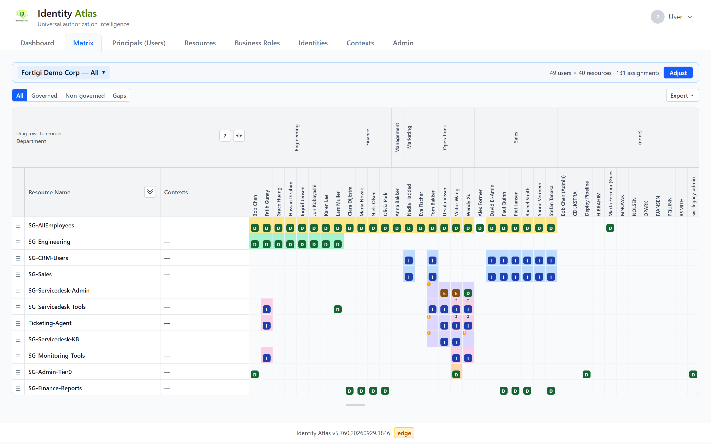
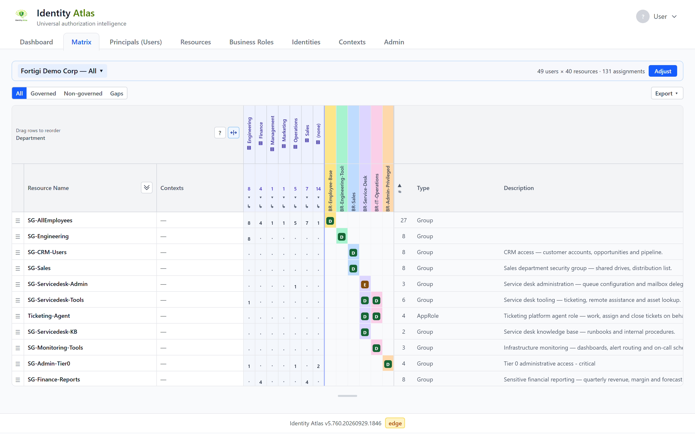

# Reading the matrix

!!! info "Before this page"
    Assumes you have read **[The app at a glance](overview.md)** and know the words
    *account*, *identity*, *resource*, *assignment* and *business role* from
    **[The words you need first](../start/glossary.md)**.

The matrix is a grid of accounts against resources. Every filled cell is one
[assignment](../start/glossary.md#5-assignment): this account holds this resource. This page
explains what each part of the grid tells you, from the outside in: the layout, the badges in
the cells, the colours, the small markers above the badges, and the controls around the grid.

The key to everything on this page is also in the app: the **?** button in the top-left corner
of the grid opens **How to read this matrix**.

---

## The layout

**By default, resources are the rows and accounts are the columns.** Each row is a group, a
role, an application permission or another resource; each column is one account, with the name
written vertically in the header.

| Part of the grid | What it shows |
|---|---|
| **Resource Name** (left, stays in place while you scroll) | The resource. Click the name to open its [detail page](detail-pages.md). |
| **Contexts** (left, next to the name) | The contexts the resource belongs to, such as a group category or a tag. The first two are shown; the rest sit behind a **+N** toggle. |
| The account columns | One column per account. Click a name to open that account's detail page. |
| The business-role columns (right of the accounts) | One coloured column per business role. See [Governed access](#governed-access-the-coloured-cells). |
| **#**, **Type**, **Description** (far right) | How many members the resource has, what kind of resource it is, and its description. Click **#** to sort the rows by member count. |

The header above the account names groups the columns. A new matrix groups them by
**Department**; the Layout step of the wizard lets you choose other attributes.

### Accounts or identities

A matrix shows either **user accounts** or **identities** as its columns. You choose this on
the **Subjects** step when you adjust the matrix.

- **User accounts**: each column is one account in one system.
- **Identities**: each column is one person, across all their accounts. A cell is filled when
  *any* of that person's accounts holds the resource.

An identity column that has linked accounts shows a small number above the name (how many
accounts) and an arrow. Click the arrow to replace the identity column with one blue-tinted
column per account, so you can see which account holds what. Click it again to fold the
accounts back into the person.

### The flipped layout

The same data can be drawn the other way round: accounts as rows, resources as columns. The
wizard has no switch for this. You get the flipped layout when you open the matrix from a
context that holds resources: on that context's page, open the **⋯** menu and choose
**View in matrix**. It lists every account that holds at least one of the context's resources.

The flipped layout is simpler than the default one. It has no business-role columns, no
expandable rows and no **Gaps** view.

---

## The badges: how the access is held

A filled cell carries a one-letter badge. There are exactly three:

| Badge | Means | Read it as |
|---|---|---|
| **D** | **Direct** | The account was given this resource itself. |
| **I** | **Indirect** | The account has it through something else, for example a group it is a member of. |
| **E** | **Eligible** | The account can switch this access on, but does not have it right now. |

The badge says *how* the access is held. It never says *what kind* of access it is; the
**Type** column on the right says that. A group membership, an application role and a consent
to an application permission all show **D** when the account holds them directly.

An empty cell means the account does not hold the resource. A cell can carry two badges when
the account holds the resource in two ways, for example both directly and through a group.

**Eligible is not current access.** An account with an **E** could activate the access, and
that is worth reviewing, but it is not using it today. That is why Eligible has its own letter
instead of being counted as Direct.

Hover a cell to read the same information as text. Where an **I** badge is clickable, clicking
it opens **How this inherited access arose**: the place the access was granted and the chain
that leads from there to the account.

### Ownership is its own row

There is no badge for "owner". Owning a group is a separate resource with its own row, and an
owner has a **D** on that row. The **Type** column tells you that the row is an ownership and
not the group itself. So an account that is both a member and an owner of a group has two
filled cells: one on the group's row, one on the ownership row.

---

## Governed access: the coloured cells

An assignment is **governed** when a business role the account holds grants it. Governed cells
have a coloured background; non-governed cells stay white.

- Each business role has its own colour, and its own column to the right of the accounts.
- A coloured cell takes the colour of the business role that grants it, so you can follow a
  colour from the cell to the role's column.
- Hover the cell to see the role's name (**Managed by: …**).
- In a business-role column, a badge on a resource's row means "this role grants this
  resource": **D** for a standing membership, **E** when the role only makes the account
  eligible. Click the role's name in the column header to open the business role.

Only business roles held by at least one account in the matrix get a column.

A white cell with a badge is access that no business role explains. That is the access to look
at first when you are cleaning up or designing roles.

### All, Governed, Non-governed, Gaps

The buttons above the grid choose which assignments you see:

| View | Shows |
|---|---|
| **All** | Every assignment in the matrix. |
| **Governed** | Only assignments granted by a business role the account holds. |
| **Non-governed** | Only assignments no business role explains. The business-role columns are hidden, because they have nothing to say here. |
| **Gaps** | Only the resources where at least one account is missing something a business role says it should have. |

Whoever saved the matrix chose which view it opens with. You can switch at any time; switching
does not change the saved matrix.

---

## The markers above the badge

Some cells carry small dots along their top edge, above the badge. There are three positions,
and each position always means the same thing:

| Position | Colour | Meaning |
|---|---|---|
| Left | Amber | **Fewer** than the business role assigns. |
| Centre | White | **More than one** business role covers this cell. The number says how many; hover the cell for their names. |
| Right | Red | **More** than the business role assigns. |

**Amber `!` (left).** A business role the account holds says the account should have this
resource, and it does not. The cell is coloured like a governed cell but has no badge, or has a
different badge than the role expects. This is usually access that was approved but never
arrived, and it is what the **Gaps** view collects.

**White number (centre).** Two or more business roles grant the same resource to the same
account. Not a problem in itself, but a sign that the roles overlap.

**Red markers (right)** only appear in a matrix that shows business roles as rows; see the next
section.

A cell can carry an amber and a red marker at the same time: short on what one role assigns,
over on another. Hovering the cell always lists every marker in words.

---

## Rows that open

A small triangle in front of a resource name means the row can be opened.

**Nested groups.** A group that is itself a member of other groups, or that has been given
application roles, shows a triangle. Opening it adds indented rows underneath for what the
group's members get through it. The button in the corner above the row names opens or closes
all of them at once.

**Business roles as rows.** A matrix normally shows business roles only as columns. When the
matrix was built with **Resources and business roles** chosen on the wizard's **Resources**
step, each business role also gets a row, with the resources it grants indented underneath it.

In such a matrix:

- A resource granted by several business roles has a row under each of them. A **BR** chip
  next to the name (or **BR+2**, and so on) says how many *other* roles grant it; hover for
  their names, click to open the role.
- Closing a business role's triangle hides its resources and leaves an "*N* resources folded"
  chip. The corner button **Fold business roles** does this for every role, leaving only the
  business roles and the resources no role grants.
- **Red `+`**: the business role only makes the account eligible for this resource, but the
  account holds it as a standing membership.
- **Red number on a resource row**: a business role hands this resource out, but no business
  role assigns it to *this* account. The account holds it by some other route. The number is
  how many roles grant the resource; the tooltip names them.
- **Numbers on a folded business role**: amber on the left counts the hidden resources the
  role assigns that the account does not have; red on the right counts the hidden resources
  the account holds that the role does not account for. Folding summarises the findings, it
  never hides them: open the role and the same markers are on the rows underneath.

---

## Folding columns and rolling up

A matrix with many accounts gets wide. Two tools make it narrower.

**Fold a column group.** The corner button **Fold all columns** replaces every top-level group
of accounts (every department, by default) with a single column. In a folded column the cell
shows a number: how many accounts in that group hold the resource directly. A dot means none.

**Roll up.** On the wizard's **Layout** step, **Roll up** can be set to **By attribute** or
**By context**. The columns then become groups (the values of an attribute such as department, or
the units of a context) and the cells become counts. A rolled-up matrix can be far larger than one
with a column per account, which makes it the way to look at a whole organisation at once.

---

## The strip above the grid

One row sits between the navigation and the grid:

- **The name**, on the left: which saved matrix you are looking at, or **Unsaved matrix**.
  Click it to open another saved matrix or start a new one.
- **Unsaved changes** appears when you opened a saved matrix and changed it since.
- **The counts**, on the right, for example *49 users × 40 resources · 131 assignments*: how
  many accounts (or identities), resources and assignments the matrix selects. This is the
  [scope](../start/glossary.md#10-scope) in numbers.
- **Adjust** opens the wizard to change who and what is in the matrix.

Saving and sharing are covered in [Sharing a matrix](sharing-a-matrix.md).

### Scope statistics

A matrix can open with a statistics panel above the grid. Tick **Show trends & breakdown above
the matrix** on the wizard's **Layout** step to add it. The panel shows:

- the number of accounts (labelled **Principals**) or **Identities**, **Resources** and
  **Assignments** in the matrix;
- a **Governed vs non-governed** bar: the share of those assignments that a business role
  explains;
- **Trends & breakdown**: how these numbers changed over time, and the governed share per
  department.

Read the governed percentage as "how much of this access is explained by a business role".
[Scope Statistics](../architecture/matrix-scope-statistics.md) explains exactly what is counted.

---

## Arranging rows and resizing

- **Drag a row** by the handle on its left to put resources in the order you want. **Reset row
  order** in the corner above the row names undoes it.
- **Drag the grip under the grid** to make the grid taller or shorter. **Fit to window** hands
  the height back to the app.

---

## Getting it into Excel

**Export → Export Excel** above the grid downloads the matrix as an `.xlsx` file. The workbook
has two sheets:

- **Role Mining Matrix**: the grid as you see it, with the same header rows, the same badges
  and cell colours, the business-role columns, and the **#**, **Type** and **Description**
  columns. The **Contexts** column lists every context in full.
- **Legend**: the badge key and the filters the matrix was built with.

The export always contains every row, including rows hidden under a folded business role, so a
file used for a review cannot leave access out.

The **Export** button is only there if your role allows exporting. To pull all Identity Atlas
data into Excel and refresh it, instead of one matrix, see
[Excel Export (Power Query)](../admin/excel-powerquery-export.md).

---

## Related

- [Reading a detail page](detail-pages.md): what you see after clicking a name in the matrix.
- [Sharing a matrix](sharing-a-matrix.md): save a matrix and give someone else a link to it.
- [Scope Statistics](../architecture/matrix-scope-statistics.md): the numbers above the grid.
- [Governance & Business Roles](../concepts/governance-model.md): what a business role is and
  why governed access matters.
